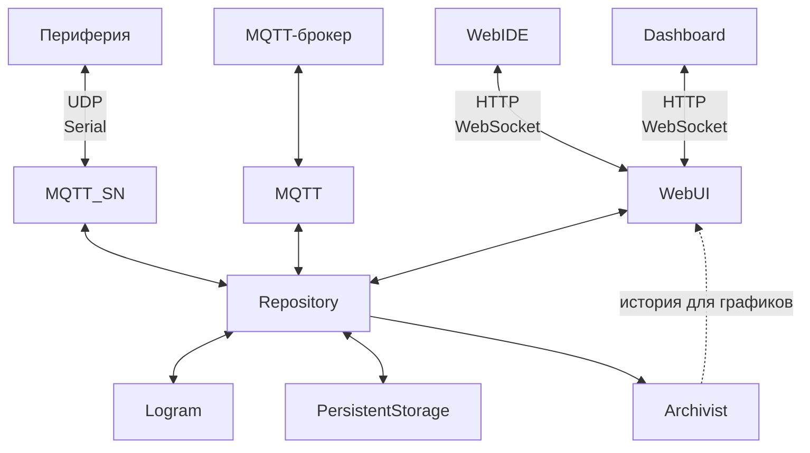

# Enviriot

**Low-code платформа для управления устройствами и автоматизации процессов.**

С её помощью можно объединять устройства в единую систему, следить за состоянием и управлять в реальном времени, выстраивая собственную логику их совместной работы.

В основе Enviriot лежат три составляющие:

- **Топики** содержат состояние, конфигурацию и описание каждого элемента системы.  
  >_Устройство, его настройка, показание датчика или результат вычисления представлены одинаково: как топики в общем дереве. Благодаря этому состояние всей системы можно наблюдать и изменять в реальном времени._
- **Лограммы** задают логику управления в виде визуальных схем.  
  >_Лограммы связывают топики в работающие алгоритмы. Визуальные блоки получают данные, обрабатывают их и передают результат дальше. Среди готовых блоков есть блок для выполнения пользовательского JavaScript, а при желании можно создать собственный вычислительный блок._
- **Плагины** добавляют новые возможности.  
  >_Плагины подключают устройства и внешние системы, обеспечивают хранение данных и накопление истории для графиков, выполняют лограммы и обслуживают пользовательские интерфейсы. Новые возможности реализуются отдельными плагинами и не требуют изменения ядра платформы._

## Как это работает

Enviriot состоит из сервера и набора плагинов. Сервер загружает компоненты, управляет их жизненным циклом и предоставляет общую среду выполнения. Плагины подключают устройства и внешние системы, сохраняют и обрабатывают данные, выполняют логику автоматизации и предоставляют пользовательские интерфейсы.

- **Repository** хранит дерево топиков и последовательно обрабатывает его изменения.
- **PersistentStorage** сохраняет состояние и конфигурацию топиков, а при запуске восстанавливает дерево.
- **Archivist** накапливает историю значений и подготавливает данные для построения графиков.
- **Logram** выполняет лограммы, передаёт данные между вычислительными блоками и записывает результаты в топики.
- **MQTT_SN** подключает устройства по протоколу MQTT-SN, используя UART или Ethernet/UDP в качестве транспорта.
- **MQTT** обеспечивает двусторонний обмен данными между топиками и внешними MQTT-брокерами.
- **WebUI** предоставляет два браузерных интерфейса:
  - **WebIDE** предназначен для настройки системы, разработки лограмм и диагностики;
  - **Dashboard** предназначен для повседневного наблюдения и управления. Каждый дашборд создаётся как отдельная HTML-страница из готовых компонентов и показывает только нужные пользователю значения, графики и элементы управления.

Основной обмен плагинов проходит через дерево топиков: они публикуют данные и подписываются на интересующие их изменения. Для отдельных задач используются общие службы сервера — например, [чтение архивной истории](plugins/Archivist/Archivist.md#чтение-истории) графиками и JavaScript.



## Документация

Подробные описания сервера и плагинов:

- [Сервер](Server/Server.md)
- [Repository](Server/Repository/Repository.md)
- [Поля State и Manifest, описания типов](Server/Repository/TopicFields.md)
- [PersistentStorage](plugins/PersistentStorage/PersistentStorage.md)
- [Archivist](plugins/Archivist/Archivist.md)
- [Logram](plugins/Logram/Logram.md)
- [MQTT_SN](plugins/MQTT_SN/MQTT_SN.md)
- [MQTT](plugins/MQTT/MQTT.md)
- [WebUI](plugins/WebUI/WebUI.md)

## Debian

Для запуска через Mono:

```sh
apt install mono-complete ca-certificates-mono
mono-service -n:Enviriot -l:/opt/enviriot/enviriot.pid -d:/opt/enviriot/bin /opt/enviriot/bin/enviriot.exe -s
```

---