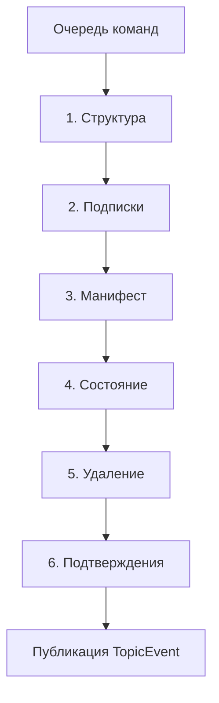

# Repository
Repository хранит общую модель системы в виде дерева топиков. Для остальных компонентов топик является одновременно адресуемым элементом дерева и единицей обмена данными.

У топика есть:

- путь, например `/A/B`;
- состояние в формате `JSValue`;
- манифест с конфигурацией и описанием;
- атрибуты, хранящиеся в поле `attr` манифеста;
- дочерние топики;
- подписки на состояние, поля манифеста и изменения структуры.

Состояние содержит текущее значение топика, а манифест описывает сам топик и правила работы с ним.
[Атрибуты](TopicFields.md#атрибуты-топика), остальные поля State/Manifest и
[описания типов](TopicFields.md#описания-типов) собраны в отдельном справочнике.
Repository хранит эти данные, но их предметную семантику и чтение описания типа
реализуют заинтересованные компоненты.

## Ответственность и контракт модуля

| Вход или выход | Ответственность Repository |
|---|---|
| Запросы к дереву | Находит топики, создаёт и перемещает узлы, подготавливает удаление поддеревьев. |
| Команды State и Manifest | Принимает их в очередь, объединяет записи одного пакета и применяет на тике. |
| Чтение | Возвращает текущее содержимое топика, а не ожидающий результат очереди. Объектные значения не являются защитной копией. |
| Подписки и события | Доставляет начальное представление и уведомления об изменениях; предметную реакцию выбирает подписчик. |
| Конфигурация | Загружает и сохраняет XST. Постоянное хранение режима DB выполняет [PersistentStorage](../../plugins/PersistentStorage/PersistentStorage.md). |

Repository не проверяет сетевые права, не исполняет лограммы и не гарантирует
сохранение каждого принятого значения на диск. В частности, `SetState`
не запрещает плагину запись в Readonly-топик: клиентские ограничения проверяет
[WebUI](../../plugins/WebUI/WebUI.md#путь-правки-из-ide).
Прикладной тип и допустимость значения не выводятся автоматически из Manifest.

Маршрут: [структура](#дерево-и-структурные-операции) →
[пакет изменений](#очередь-изменений-и-тик-repository) →
[доставка](#подписки). Сквозной пример —
[State от 20 к 21 в Inspector](../../plugins/WebUI/WebUI.md#путь-правки-из-ide).
Место Repository в движковом цикле определяет
[хост](../Server.md#проход-движка).

Ниже указаны правила, которые проверяют существующие тесты, и оставшиеся
пробелы. Это описание покрытия по исходникам, не отчёт об успешном прогоне.
[RepoTestBase](../../Tests/Repository/RepoTestBase.cs) создаёт отдельное дерево
и вызывает тик вручную, без запуска всего сервера.

## Дерево и структурные операции

**Задача.** Поддерживать адресуемую структуру, сохраняя различие между
доступностью узла в дереве и объявлением изменения подписчикам.

**Контракт.** `Get` принимает абсолютный или относительный путь и по умолчанию
создаёт отсутствующие узлы; `Get(create: false)` и `Exist` лишь ищут.
Пустой путь обозначает исходный топик, `/` — корень. Имена сравниваются
с учётом регистра; `/` разделяет узлы, а точка внутри имени не разделяет путь.
Пустые сегменты пути пропускаются. Собственное имя не может быть пустым,
состоять только из пробелов, содержать `/` или быть ровно `+` либо `#`.

| Операция | Что видно сразу | Что происходит на тике |
|---|---|---|
| Создание через `Get` | Узел уже доступен по пути; у нового узла State равен `undefined`. | Публикуется `Created`. |
| `Move` | Меняются родитель, имя и пути всего перемещаемого поддерева. | Для перемещаемого узла публикуется `Moved` с прежним путём и родителем. Отдельных `Moved` для каждого потомка нет. |
| `Remove` | Помечается сам удаляемый узел; поиск из родителя и обычный обход перестают заходить в эту ветвь. | Удаление распространяется на потомков, State очищается, узлы отсоединяются и получают `Removed`. |
| `Declare` и `Fill` | `Declare` делает узел доступным без объявления. `Fill` сразу задаёт Manifest и, если передан State, его значение. | `Fill` ставит `Created`, а не отдельные `StateChanged`/`FieldChanged`. |

`Fill` — специальный путь первоначального заполнения и восстановления,
а не обычная отложенная правка. Он заменяет Manifest, при его отсутствии
создаёт пустой и обеспечивает числовой `attr`. C# `null` вместо State
оставляет прежний State; явный `JSValue.Null` задаёт значение `null`.
Вызывающий `Declare` отвечает за последующий `Fill`.

Путь не является постоянным идентификатором объекта. Между `Remove` и тиком
по тому же пути может быть создан другой экземпляр: отложенное отсоединение
старого узла не удаляет замену. Повторный `Remove` старого экземпляра
не создаёт второе событие.

**Границы и ошибки.** Недопустимое имя, занятое место назначения или перенос
в собственное поддерево отклоняются исключением; корень и удалённый узел
перемещать нельзя. Поиск без создания возвращает отсутствие, но тоже может
отклонить недопустимый сегмент, если дошёл до него.
Создание длинного пути проверяет сегменты по мере продвижения: ошибка
позднего сегмента не откатывает уже созданных предков. Это отличается от
[предварительной проверки XST](../Server.md#импорт-поддерева).

Структурные операции синхронизируют свои записи, но не превращают весь обход
дерева или чтение State в неизменяемый снимок. Ссылка на потомка удаляемого
узла до тика ещё может указывать на не помеченный удалённым объект.

**Реализация.** [Topic.Get, Resolve, Move, Remove, Declare, Fill, Unlink, Bill](Topic.cs).

**Проверки.** [TopicNameTests](../../Tests/Repository/TopicNameTests.cs)
проверяют правила имён и сегментов. В
[TopicTreeTests](../../Tests/Repository/TopicTreeTests.cs):
`Get_CreationIsAnnouncedOnTheNextTick`,
`Fill_SetsTheStateAtOnceAndAnnouncesTheTopic`,
`Move_ToAnotherParentUpdatesTheWholeSubtree`,
`Remove_CascadesToTheWholeSubtree` и
`Remove_ReplacementUnderTheSamePathSurvivesTheUnlink`
проверяют границы видимости, каскад и сохранность замены.
Это не проверки конкурентных перемещений и обходов из нескольких потоков.

## Очередь изменений и тик Repository

**Задача.** Применить пакет отложенных изменений до его публикации,
чтобы подписчик не наблюдал промежуточные стадии этого пакета.

**Контракт.** `SetState` и `SetField` ставят команды, не меняя значение
в месте вызова. Возврат из них означает постановку, а не применение.
Пустой путь `SetField` отклоняется исключением; `TrySetField` в этом случае
возвращает `false`. Обе формы не подтверждают будущую успешность обработки.

Тик извлекает команды до опустошения очереди и раскладывает их по фазам,
затем применяет все фазы, а только после этого публикует накопленные события
в том же порядке:

Фаза структуры объявляет в том числе изменения, которые
[уже произошли в вызывающем потоке](#дерево-и-структурные-операции).
Снимки новых подписок готовятся при разборе очереди, но доставляются
в своей фазе публикации. Команда из обработчика события ждёт следующего тика;
команда, поступившая ещё во время извлечения очереди, может войти в текущий
пакет. Фиксированного снимка всей входной очереди в начале тика нет.

Несколько записей State одного топика объединяются: остаются последнее
значение и автор, но место команды соответствует первой записи.
Для Manifest ключ объединения — топик и точная строка пути поля.
Записи формируют один новый Manifest, а каждый действительно изменившийся
путь получает своё событие. Равенство проверяется через
[JsLib.SameValue](../Server.md#значения-jsvalue), не глубоким сравнением JSON.
Неизменившееся значение не обязано породить событие.

`Cmd` — внутренний запрос, `TopicEvent` — опубликованный результат либо
служебное уведомление подписки. `Source` ссылается на живой топик;
событие не хранит отдельную копию его нового состояния. `Author` сохраняет
переданный топик-источник или `null`: потребитель может использовать его
для подавления эха, но Repository не фильтрует такие события автоматически.

**Границы и ошибки.** Применение перед публикацией гарантирует порядок
внутри пакета, а не транзакционную изоляцию от структурных правок других
потоков или самих обработчиков. Нельзя менять полученный объект State
на месте и ожидать, что Repository сам обнаружит изменение.

Ошибка отдельной команды или подписчика журналируется, остальные элементы
продолжают обрабатываться; уже выполненная работа не откатывается.
Ошибочная команда автоматически не повторяется, а подписчик не отключается.
Повторный вход в занятый `Tick` не запускает вложенный проход; до `Init`
тик также не обрабатывает команды. Размер очереди и время обработки пакета
не ограничены, поэтому это не обещание предельной задержки.

**Реализация.** [Repo.DoCmd, Dispatch, Tick](Repo.cs);
[Phase, CmdState.Apply, CmdField.Apply](Cmd.cs); [TopicEvent](TopicEvent.cs).

**Проверки.** [RepoTickTests](../../Tests/Repository/RepoTickTests.cs):
`Tick_AppliesEverythingBeforePublishingAnything`,
`DoCmd_QueuedWhilePublishingWaitsForTheNextTick`,
`SetState_TheSecondWriteKeepsThePlaceOfTheFirst`,
`Tick_AFailingCommandDoesNotLoseTheRest` и
`Tick_FromInsideASubscriberDoesNothing`.
[TopicStateFieldTests](../../Tests/Repository/TopicStateFieldTests.cs)
проверяют отложенное применение и объединение полей,
а [TopicEventTests.Author_OfAStateChangeIsTheOneWhoWrote](../../Tests/Repository/TopicEventTests.cs) —
перенос автора. Нагрузочный предел очереди и изоляция от произвольной
конкурентной правки объектных значений этими тестами не проверяются.

## Подписки

**Задача.** Дать потребителю начальное представление нужной области
и доставлять относящиеся к ней события без копирования подписки во все узлы.

**Контракт.** Подписка экземпляра `Topic` хранится на этом топике,
а при публикации выбирается подъёмом от `Source` к предкам.

| Маска | Область или вид событий |
|---|---|
| `Once` | Сам топик; это не ограничение числа вызовов. |
| `Children` | Только непосредственные дети. |
| `All` | Сам топик и всё его поддерево. |
| `Value` | Изменения State внутри выбранной области. |
| `Field` | Изменения Manifest; необязательный префикс выбирает его ветвь. |

Структурным событиям не требуются биты `Value` или `Field`.
Префикс поля сравнивается по сегментам: изменение внутри ветви и замена
всей охватывающей её ветви подходят, соседняя ветвь — нет.
Доставка также проверяет, изменилось ли значение самого префикса.

Для новой подписки ставится команда начального обхода. В её пакете
`Snapshot` предшествует событиям изменения содержимого, а `Ready`
публикуется в последней фазе, даже если снимок пуст.
**Snapshot не содержит замороженной копии State**: обработчик читает
`Source` после применения всего пакета. Поэтому снимок и следующий за ним
`StateChanged` могут показать одно и то же новое значение.
`Ready` завершает начальную доставку, а не подтверждает сохранение данных.

Для `Once` снимок самого топика приходит и при отсутствии запрошенного поля.
При обходе поддерева `Field` с непустым префиксом отбирает узлы,
имеющие это поле; добавление `Value` снимает этот фильтр снимка.
Повторная подписка тем же делегатом, маской и значимым префиксом возвращает
прежний `SubRec`: повторяется `Ready`, но не начальный обход.

Перемещение объявляется по новой и прежней цепочке родителей, чтобы обе
стороны узнали об изменении состава. Подписка общего предка получает это
событие один раз. Сама регистрация остаётся на своём объекте Topic
и сохраняется при его перемещении.

Отдельная статическая форма `Topic.Subscribe(Action<TopicEvent>)`
наблюдает все публикуемые события, включая `Snapshot` и `Ready` чужих
подписок. Она не создаёт собственного начального обхода или подтверждения.

**Границы и ошибки.** Регистрация становится активной сразу, а начальная
команда обрабатывается позже. Подписка, добавленная во время публикации,
может получить оставшиеся события текущего пакета до своего начального
обхода. Нельзя считать `Ready` общей блокировкой всех обновлений.

Владелец освобождает `SubRec` или глобальную подписку через `Dispose`.
Это снимает регистрацию, но не является барьером для уже взятого списка
обработчиков или подготовленного адресного `Snapshot`/`Ready`.
Эквивалентные регистрации, вернувшие один `SubRec`, не имеют независимого
счётчика владельцев.

Callback выполняется синхронно при публикации на тике Repository.
Его исключение изолируется и журналируется, но медленный обработчик
задерживает остальных; повторной доставки пропущенного им результата нет.

**Реализация.** [Topic.Subscribe, Find, Publish, Deliver, SameBranch, Unsubscribe](Topic.cs);
[Repo.Snapshot, SubscribeAll](Repo.cs); [SubRec.Dispose](SubRec.cs).

**Проверки.** [RepoSubscriptionTests](../../Tests/Repository/RepoSubscriptionTests.cs):
`Subscribe_TheSnapshotPrecedesChangesMadeInTheSameTick`,
`Subscribe_TheSameHandlerTwiceIsNotSnapshottedAgain`,
`Subscribe_ACallbackMayUnsubscribeAnotherOne`.
[RepoDeliveryTests](../../Tests/Repository/RepoDeliveryTests.cs) проверяют
маски и префиксы, в том числе
`Deliver_AWriteOverTheWholeBranchReachesAPrefixInsideIt`,
`Deliver_AMoveIsAnnouncedUnderBothParents` и
`Deliver_AMoveInsideOneSubtreeIsAnnouncedOnce`.
Изоляцию ошибки проверяет
[RepoTickTests.Tick_AFailingSubscriberDoesNotStopTheOthers](../../Tests/Repository/RepoTickTests.cs).
Освобождение перед доставкой уже подготовленного адресного снимка и гонки
подписки из разных потоков отдельными тестами не проверены.

## Конфигурация и перенос поддеревьев

**Задача.** Восстановить начальную конфигурацию и сохранять её изменения,
не смешивая этот цикл с сохранением DB-состояний или подтверждением правки.

**Контракт.** Repository всегда включён и первым создаёт корень в `Init`.
Затем он импортирует настроенный XST и выполняет два начальных тика.
Отсутствующий файл не считается ошибкой запуска: файловый `Import`
возвращает `false`, и инициализация продолжается.
Признак завершённой загрузки устанавливается только после всего `Init`.
Загрузка базы PersistentStorage — отдельный этап его `Start`.

`Repo.Start` подключает наблюдение за событиями конфигурации.
Автосохранение планируется по `StateChanged`, `FieldChanged` и `Removed`,
если источник в момент обработки события имеет режим `Config`.
Каждое подходящее событие переносит срок на пять секунд вперёд.
После наступления срока один из тиков экспортирует корень в режиме
`configOnly`: частые изменения объединяются, а непрерывные могут
постоянно отодвигать запись.

Запись выполняется синхронно внутри тика. При ошибке исключение
журналируется и назначается повторная попытка через 30 секунд.
Новое событие конфигурации может снова назначить обычный пятисекундный срок.
Точность этих сроков ограничена работой движка.

`Repo.Stop` экспортирует текущую конфигурацию, только если `Init`
дошёл до конца. После ошибки первоначального импорта исходный файл
не заменяется частично загруженным деревом.
Правила переноса, версий и файловой подмены описаны в
[XST](../Server.md#импорт-экспорт-и-конфигурация).

**Границы и ошибки.** Автосохранение не наблюдает любое изменение дерева:
сами `Created` и `Moved` его не планируют, а снятие режима `Config`
может уже не пройти отбор по текущим атрибутам.
`Stop` не опустошает очередь отложенных команд перед экспортом.
Успешный тик и опубликованное событие не подтверждают запись файла,
а успешный `Init` не означает, что импорт принял каждый JSON-атрибут
без предупреждений. Экспорт DB-состояний этим механизмом не выполняется.

**Реализация.** [Repo.Init, Start, PublishSaveConfig, Tick, Stop](Repo.cs);
[Xst.Import, Export](Xst.cs).

**Проверки.** [RepoTickTests.Start_DoesNotSaveBeforeTheDelay](../../Tests/Repository/RepoTickTests.cs)
проверяет только отсутствие файла сразу после изменения Config-топика.
Он не ждёт сохранения и не проверяет содержимое XST.
Успешная отложенная запись, повтор после отказа, отбор структурных событий
и защита исходной конфигурации при неудачном `Init` отдельными тестами
не проверены.

## JSValue

Состояния и манифесты представлены значениями NiL.JS. Общие правила чтения,
подготовки объектов, сравнения и JSON описаны в
[механизме JSValue сервера](../Server.md#значения-jsvalue).
Работа с отдельным значением не заменяет постановку изменения топика
в [очередь Repository](#очередь-изменений-и-тик-repository).

## RPC

RPC — [общая служба сервера](../Server.md#rpc), а не фаза Repository.
Она передаёт обработчику топик и аргумент; если действие меняет State
или Manifest, эти записи отдельно проходят очередь Repository.
Возврат из RPC и применение изменений дерева не являются одним событием.

## Поддержание актуальности

- Изменения структуры, пакета и доставки сопровождаются правкой
  соответствующего механизма здесь и его проверок.
- Правила формата, версии и файлового экспорта меняются в
  [описании XST](../Server.md#формат-xst), не копируются в документы потребителей.
- При изменении подтверждения правки или доставки представления обновляется
  [сквозной сценарий WebUI](../../plugins/WebUI/WebUI.md#путь-правки-из-ide).
- Значение прикладного поля относится к [общему справочнику](TopicFields.md)
  или документу владеющего им плагина, а не к алгоритму Repository.

---

[Вернуться к основному README](../../README.md)
