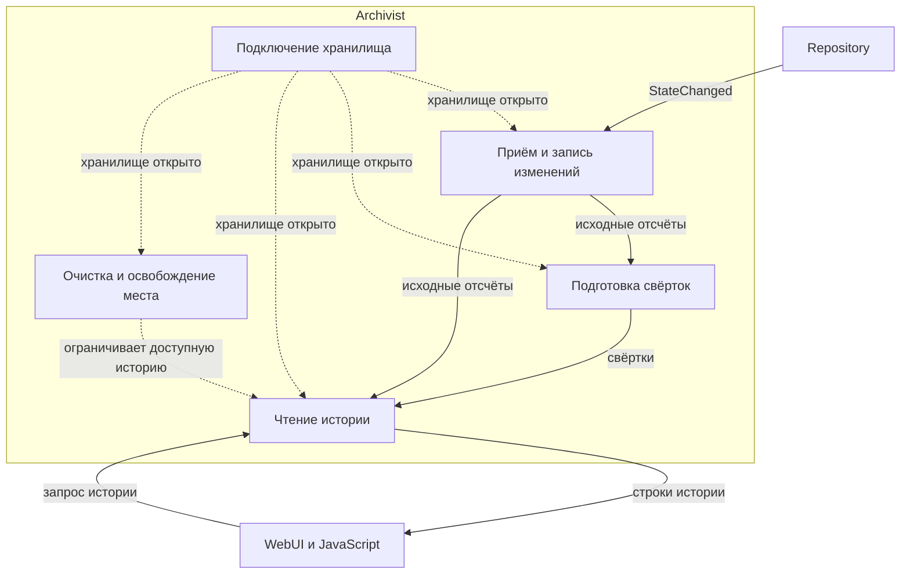

# Archivist

Archivist накапливает историю числовых значений топиков и предоставляет общую
модель чтения для графиков и JavaScript. Пользователь может посмотреть, как
менялось показание, а лограмма — запросить данные за интервал.

Это область истории значений в [общей архитектуре Enviriot](../../README.md#как-это-работает),
а не сохранение текущего состояния системы.

Навигация: [контракт модуля](#ответственность-и-контракт-модуля),
[ключи и время](#ключи-хранения-и-временная-модель),
[механизмы](#механизмы), [сквозной сценарий](#сценарий-от-изменения-state-до-истории-на-графике),
[проверки](#проверки-и-пробелы), [уточнения прежнего описания](#уточнения-прежнего-описания).

## Ответственность и контракт модуля

| Участник | Ответственность и граница |
|---|---|
| [Repository](../../Server/Repository/Repository.md) | Применяет State и публикует события. Archivist получает уже опубликованные изменения, но не управляет очередью Repository. Понятия Topic, State и Manifest определены в документе Repository. |
| Archivist | Отбирает изменения, записывает отсчёты, строит свёртки, читает и удаляет историю по сроку хранения. Входы: события, поля `Arch` манифеста, запросы по путям и времени. Выходы: файлы архива и массивы строк истории. |
| [PersistentStorage](../PersistentStorage/PersistentStorage.md) | Восстанавливает дерево и сохраняет текущее состояние и манифесты. Его база не заменяет историю Archivist; атрибут `DB` не включает архивирование. |
| [WebUI](../WebUI/WebUI.md) и графики | Проверяют доступ к HTTP-запросу, передают его общему поставщику архива и показывают ответ. Отрисовка, клиентский кэш и текущие значения по WebSocket находятся вне Archivist. |
| [JavaScript в Logram](../Logram/Logram.md#поддержка-javascript) | Получает историю через `Arch.Query`. Общая серверная точка чтения — [JsExtLib.AQuery](../../Server/JsExtLib.cs), а не событие или состояние топика. |

**Изменение State, попадание события в очередь Archivist, запись в LiteDB
и появление точки на графике — разные этапы.** Ни событие Repository, ни живая
точка в браузере не являются подтверждением сохранения истории.

### Настройки плагина

Задаются состояниями служебных топиков и действуют на Archivist целиком.

| Где | Смысл |
|---|---|
| State `/$YS/Archivist` | Включение плагина при запуске. Если значение не Boolean, плагин задаёт `true` и атрибуты `Required`, `Readonly`, `Config`. Это не переключатель отдельного ряда. |
| State `/$YS/Archivist/verbose` | Диагностика запросов; по умолчанию `false`. Изменяется через подписку. В журнал попадают окно, число топиков, выбранный уровень, прочитанные строки, выданные точки и длительность. |

Опорная реализация: [ArchivistPl.enabled, Start](ArchivistPl.cs).

### Настройки топика

Формат полей `Arch.enable` и `Arch.keep`, приведение типов и значения
по умолчанию описаны в [справочнике полей Topic](../../Server/Repository/TopicFields.md#архивирование).
Ниже — порядок применения этих настроек.

Срок и выбор файла перечитываются при обработке следующего пригодного для
записи изменения, а не непосредственно при изменении поля `Arch.keep`.
Включение `Arch.enable` само по себе не записывает уже существующий State:
нужно последующее событие изменения состояния.

**Отключение `Arch.enable` — не пауза с сохранением истории:** фоновая очистка
считает такой ряд ненужным и удаляет его данные. Удаление топика имеет то же
последствие. Подробности — в [механизме очистки](#очистка-и-освобождение-места).

Опорная реализация: [ArchivistPl.SubFunc](ArchivistPl.cs),
[ArchStore.RefreshKeep](ArchStore.cs), [ArchRetention.IsOrphan](ArchRetention.cs).

## Ключи хранения и временная модель

Это общие правила записи, чтения и обслуживания истории, а не отдельный механизм.

**Почему составной ключ.** Реестр связывает путь топика с идентификатором ряда.
Первичный ключ исходного отсчёта объединяет этот идентификатор и время,
ключ свёртки — идентификатор и номер корзины. Путь не повторяется в каждой записи.
В LiteDB двоичные ключи сравниваются побайтово; кодирование исходных отсчётов
сохраняет порядок «ряд, затем время».
Такой порядок позволяет читать и удалять временной диапазон одного ряда по
первичному ключу, без отдельного индекса по топику и просмотра чужих рядов.
Обратная сторона — для общего порядка времени в запросе нескольких рядов
нужно сливать их потоки.

Побайтовая раскладка ключей, порядок байтов и допустимые диапазоны описаны
только возле [ArchTime.PackSample, PackId](ArchTime.cs). Упаковка не обеспечивает
уникальность повторяющихся временных меток: обработка последовательных повторов
находится в [ArchStore.NextTicks](ArchStore.cs).

**Почему UTC.** Времена отсчётов, курсоры обслуживания и границы свёрток
представлены в UTC. Местное время при переводе часов может повторяться, поэтому
оно не подходит для различения моментов и расчёта длительностей.
LiteDB возвращает поля DateTime в местном времени; двоичный ключ исходного
отсчёта обходит это преобразование, а загруженные курсоры приводятся обратно
к UTC.

Местное время остаётся на явно определённых границах:

- [ArchQuery.Run](ArchQuery.cs) нормализует входные даты запроса в UTC;
  [ArchAccumulator.Raw, Resample](ArchAccumulator.cs) создают выходные JS Date
  через локальное время, затем HTTP сериализует их в JSON.
- [ArchStore.LoadTopics](ArchStore.cs) нормализует курсоры, прочитанные из LiteDB.
  На существующей границе очистки [ArchRetention.Step](ArchRetention.cs)
  передаёт местные даты в [ArchStore.PurgeRaw](ArchStore.cs), который переводит
  их в UTC для построения ключей.
- Ночная проверка перестроения выбирается по местным часам;
  [ArchivistPl.NextNightly](ArchivistPl.cs) возвращает её время в UTC.
  Расписание описано в [механизме очистки](#очистка-и-освобождение-места).

**UTC и начало сетки — разные правила.** Сохранённые корзины нумеруются от
[ArchTime.Epoch](ArchTime.cs), серверная сетка ответа
[ArchQuery.Snap](ArchQuery.cs) — от начала календаря .NET, клиентская
[snapWindow](../../Output/www/components/graph-grid.js) — от Unix epoch.
Для недельного шага начала клиентской и серверной сеток различаются на три дня.
Полное совпадение сеток сейчас не гарантируется; это известное расхождение,
а не новая норма контракта.

Проверки формата ключей и временной модели отсутствуют; см.
[матрицу проверок](#проверки-и-пробелы). Наличие этих правил в описании
не заменяет испытаний хранения и расчётов.

## Механизмы

Внутри границы Archivist показаны пять механизмов; каждому соответствует
одноимённый раздел ниже. Сплошные стрелки обозначают движение данных, пунктирные —
условия работы. Передача отсчётов и свёрток между механизмами идёт через
хранилище, а не прямыми вызовами.

### Подключение хранилища

**Задача.** Сделать историю доступной после восстановления дерева и не оставить
входы плагина подключёнными к закрытой базе.

**Контракт.** Плагин имеет приоритет 3: после Repository и PersistentStorage.
Рабочий поток открывает три файла, а запуск ожидает результата открытия.
Только после успеха устанавливаются глобальная подписка на события и
поставщик [JsExtLib.AQuery](../../Server/JsExtLib.cs). Существующий реестр рядов
загружается сразу, поэтому обслуживание не требует первого нового показания.

При ошибке открытия освобождаются уже открытые базы, а запуск выбрасывает
исключение с причиной и путём к хранилищу. При остановке сначала снимаются
подписки и собственный поставщик запросов, затем останавливается рабочий поток
и закрываются файлы. Чужой поставщик, успевший заменить этот, не сбрасывается.
На ожидание потока отведено 5 секунд; при превышении срока пишется ошибка,
поток принудительно не прерывается и хранилище не уничтожается под ним.

**Границы.** Нет обещания опустошить очередь при остановке или сохранить
ещё не обработанные события после аварии. Чтение не имеет общей с записью
транзакции «изменил State — сразу получил его из архива».
Открытие собственных файлов не означает автоматическую миграцию старых архивов.

**Реализация.** [ArchivistPl.Init, Start, Stop, ThreadM](ArchivistPl.cs);
[ArchStore.Open, LoadTopics, Close](ArchStore.cs).

**Проверки.** В checkout нет тестов открытия, восстановления реестра и остановки
Archivist; [статус проверок](#проверки-и-пробелы).

### Приём и запись изменений

**Задача.** Отделить обработку событий Repository от дисковых операций.

**Контракт.** Глобальная подписка принимает только `StateChanged` с источником,
включённым `Arch.enable` и автором, отличным от владельца Archivist.
Обработчик ставит событие в очередь; тик плагина пробуждает рабочий поток.
В потоке читается **текущий** State источника через
[JsLib.AsDouble](../../Server/JsLib.cs). Нечисловые состояния (в том числе
строки с числами), `NaN` и бесконечность не записываются.

Для подходящего значения определяется ряд и выполняется отдельная вставка
в LiteDB. Время отсчёта — серверное UTC-время вызова записи, не время измерения
устройства и не время команды изменения State.

Файлы находятся в `../data` относительно рабочего каталога процесса:

| Файл | Что хранится |
|---|---|
| `arch_raw.ldb` | Исходные отсчёты рядов со сроком хранения больше 0,1 суток. |
| `arch_hot.ldb` | Исходные отсчёты коротких рядов: `0 < Arch.keep <= 0.1`, то есть до 2 ч 24 мин включительно. Это дисковое хранилище, а не только память. |
| `arch_meta.ldb` | Реестр путей и идентификаторов, сроки и курсоры обслуживания, свёртки за 5 минут, час и сутки. |

При переходе срока через порог новые записи идут в другой файл,
а прежние остаются на месте. Поток чтения исходных отсчётов объединяет оба файла.
При следующей записи после переименования тот же объект Topic позволяет
обновить путь без создания нового ряда.

**Границы.** Это история наблюдённых состояний, не журнал всех команд:
Repository объединяет записи внутри тика, а очередь Archivist хранит событие
со ссылкой на Topic, не снимок нового значения. При отставании рабочего потока
несколько событий могут прочитать уже более поздний State.
Нет периодического опроса неизменившихся значений. Перемещение без новой записи
само по себе не обновляет архивный путь; сохранение такой связи через перезапуск
не гарантируется. Ошибка отдельной записи журналируется, повторной постановки
события в очередь нет.

**Реализация.** [ArchivistPl.SubFunc, Tick, StoreOne](ArchivistPl.cs);
[ArchStore.Resolve, RefreshKeep, Append, Stream](ArchStore.cs);
[ArchTime.PackSample](ArchTime.cs).

**Проверки.** Отложенное применение, объединение и отсутствие события при
повторном State проверяются [тестами Repository](#проверки-и-пробелы).
Отбор, очередь, запись, переименование и смена файла Archivist не покрыты.

### Подготовка свёрток

**Задача.** Читать большие интервалы без перебора всей исходной истории.

**Контракт.** В свободные проходы рабочего потока ряды обходятся по очереди.
За проход обрабатывается один ожидающий час ряда. Короткие ряды из категории
hot не сворачиваются. Обрабатываются завершённые часы за границей
`текущее UTC-время − 0,1 суток`; это запас до свёртки, а не обещанная задержка
обслуживания.

Из одного чтения исходного часа получаются часовая и двенадцать пятиминутных
корзин. При переходе на следующие сутки дневная корзина строится из часовых.
Корзина хранит взвешенное по времени среднее, число отсчётов и последнее
значение для продолжения ряда. Предыдущее известное значение участвует в начале
интервала; при его отсутствии первый отсчёт заполняет начало. Пустые корзины
не записываются. Курсор отмечает пройденные часы и сохраняется в реестре.

**Границы.** Свёртки не заменяют исходные отсчёты до истечения срока хранения
и не являются сохранением минимумов и максимумов: пик на обзорном графике может
быть сглажен. Пройденные интервалы автоматически не пересчитываются при позднем
добавлении данных. Расписание фонового потока не задаёт предельного времени
готовности свёрток.

**Реализация.** [ArchivistPl.IdleTask](ArchivistPl.cs);
[ArchRollup.FoldHour, FoldInto, FoldDay, Fold](ArchRollup.cs);
[ArchStore.UpsertBucket](ArchStore.cs), [ArchTime](ArchTime.cs).

**Проверки.** Тестов средних, пустых часов, задержки и восстановления курсоров
в checkout нет; [непроверенные правила](#проверки-и-пробелы).

### Чтение истории

**Задача.** Предоставить графику и скрипту один формат рядов, выбирая источник
по требуемому временному разрешению.

**Контракт входа.** Общий запрос содержит упорядоченный список путей,
начало `begin`, количество `count` и необязательный конец `end`.
Отсутствующий конец на сервере представлен `DateTime.MinValue`.

| Условие | Режим и границы |
|---|---|
| `end > begin`, `count != 0` | Пересчёт на временные корзины; знак `count` не задаёт направление, используется модуль. |
| `count == 0` | Исходные отсчёты от `begin` до `end` включительно. При `end < begin` результат пуст; при равенстве возможен отсчёт ровно на границе. |
| `end <= begin`, `count < 0` | До `abs(count)` исходных отсчётов строго раньше `begin`, от новых к старым. |
| `end <= begin`, `count > 0` | До `count` исходных отсчётов строго позже `begin`, от старых к новым. |

Модуль входного `count` ограничивается 10 000. Чтение raw для диапазона или
сырого хвоста ограничено 500 000 отсчётов; это предел чтения, не обещание
получить столько строк ответа. При достижении предела поток останавливается
с предупреждением в журнале, без отдельного признака усечения в ответе.

В режиме пересчёта источник выбирается по шагу `(end − begin) / abs(count)`:

| Шаг | Предпочтительный источник |
|---|---|
| Меньше 5 минут | Исходные отсчёты. |
| От 5 минут до часа | Пятиминутные свёртки. |
| От часа до суток | Часовые свёртки. |
| От суток | Дневные свёртки. |

Шаг округляется вверх до целого числа исходных корзин (для raw — секунд),
а окно расширяется наружу до абсолютной сетки. До общей границы готовности
запрошенных рядов читаются свёртки, после неё — raw. Если свёртки для окна
ещё не готовы, используется raw. Поэтому выбранный уровень не означает,
что весь запрос прочитан только из него.

**Контракт выхода.** Результат — массив строк `[timestamp, value1, value2, ...]`;
порядок столбцов соответствует списку путей. Значения — числа или `null`;
неизвестный путь не удаляет свой столбец. Представление времени и начала сеток
определены в [общей временной модели](#ключи-хранения-и-временная-модель).

- В исходном режиме несколько серий могут объединяться в строку с незаполненным
  столбцом; это не обязательно один физический отсчёт на одну строку. Для прямого
  хода используется окно менее 15 секунд от начала строки.
- При пересчёте берётся предыдущее известное значение. Если в корзине меньше двух
  новых отсчётов ряда, возвращается последнее известное значение, а если его нет —
  `null`. При нескольких отсчётах используется взвешивание по времени.
- Промежуточные пустые корзины могут пропускаться; окно расширяется и его
  количество корзин пересчитывается. **Ровно `abs(count)` строк не гарантируется**,
  как и жёсткий предел в 10 000 строк после выравнивания.
- Метка строки при единственном отсчёте остаётся временем этого отсчёта;
  в остальных случаях используется середина выходной корзины. Не каждая метка
  обязана быть узлом одной равномерной сетки.

**Границы.** Это модель данных для графика, не точный перечень событий и не
универсальное статистическое среднее: правило одиночного отсчёта при чтении
отличается от построения сохранённой свёртки.
Поиск предшествующего raw-значения без подходящей часовой корзины ограничен
двумя сутками. Этот поиск использует только текущий файл ряда, хотя чтение
самого интервала объединяет оба: смена hot/raw может влиять на заполнение начала.
Исчезнувшая исходная детализация не восстанавливается из средних.

#### Входы клиентов и ошибки

| Вход | Передача запроса и ответственность |
|---|---|
| `GET /api/archivist` | WebUI принимает `p` (JSON-путь или массив путей), `b` (JSON-дата начала), необязательные `e` (JSON-дата конца) и `c` (количество, по умолчанию 0). Нужен действующий токен `t`. WebUI проверяет доступ ко всем различным путям и вызывает общего поставщика. |
| JavaScript `Arch.Query` | [JsExtLib.AQueryJS](../../Server/JsExtLib.cs) преобразует пути и даты и запускает запрос через Task. Это серверный вызов; HTTP-токен и проверки сетевого доступа WebUI к нему не относятся. |

Для HTTP недействительный токен даёт 404, ошибка разбора — 400 с кодом
`archivist_bad_request`, запрещённый путь — 403 для всего запроса,
отсутствие поставщика — 503 с кодом `archivist_unavailable`.
Успешный HTTP-ответ содержит массив истории и `Cache-Control: no-store`.
JS-обёртка при отсутствии поставщика или недопустимых обязательных аргументах
выбрасывает исключение.

Внутри поставщика исключение чтения журналируется и превращается в `[]`.
Закрытое хранилище или пустой список путей также дают `[]`.
**Пустой массив сам по себе не доказывает отсутствие истории**: HTTP может
успешно передать пустой результат после внутренней ошибки Archivist.
Отмена fetch в браузере не отменяет уже начатое серверное чтение.

**Реализация.** [ArchQuery.Run, Snap](ArchQuery.cs);
[ArchTime.Granularity](ArchTime.cs);
[ArchStore.Stream, RollStream, RollupHorizon, Seed](ArchStore.cs);
[ArchAccumulator.Raw, Resample](ArchAccumulator.cs);
[ArchivistPl.AQuery, Describe](ArchivistPl.cs).
Граница HTTP — [WebUiHost.ServeArchivist, TryParseArchivistQuery, FirstRefusedTopic](../WebUI/WebUiHost.cs);
общая клиентская арифметика — [pickStep, snapWindow, mergeRows](../../Output/www/components/graph-grid.js).

**Проверки.** Тестов режимов запроса, формы ответа, усечения, сеток, HTTP/JS-входов
и заполнения пропусков в checkout нет. Проверка файлов и символов не заменяет
эти испытания; [матрица проверок](#проверки-и-пробелы).

### Очистка и освобождение места

**Задача.** Ограничить историю сроком хранения и отдельно возвращать лишнее
место файловой системе.

**Контракт.** В свободном проходе сначала предпринимается шаг свёртки.
Если он не записал непустой час, предпринимается шаг очистки того же ряда.
Очистка продвигается не более чем на сутки истории за проход; удаляются raw
из обоих файлов и целые устаревшие корзины всех уровней.
Для действующего ряда граница — `текущее время − сохранённый срок keep`.
Между продвижениями выдерживается накопление просроченного интервала:
четверть срока хранения, но не меньше минуты и не больше часа.
Поэтому `Arch.keep` не является точным сроком удаления до секунды.

Если связанный Topic отсутствует, удалён или больше не включает `Arch.enable`,
очистка проходит всю историю; после достижения текущего времени удаляются
остатки данных, свёртки и запись реестра.

Удаление строк не обязано уменьшить размер файла: LiteDB переиспользует
освободившиеся страницы. Возможность перестроения hot-файла проверяется раз
в час, raw-файла — в 03:45 по локальному времени. Перестроение имеет смысл,
только если файл не меньше 4 МиБ и больше оценки живых строк
`число строк × 129 байт × 1,5`. Это оценка свободного места, не формат записи.
Если файл занят чтением, исключительная блокировка не ожидается и попытка
откладывается. Автоматического перестроения meta-файла здесь нет.

**Границы.** Очистка и перестроение — не резервное копирование и не миграция.
Непрерывный поток записей может отложить обслуживание. Ошибки обслуживания
журналируются; точная максимальная задержка не гарантируется.
Отключать архивирование, рассчитывая сохранить старый ряд, нельзя.

**Реализация.** [ArchivistPl.IdleTask, Reclaim, NextNightly, WorthRebuilding](ArchivistPl.cs);
[ArchRetention.Step, IsOrphan](ArchRetention.cs);
[ArchStore.PurgeRaw, PurgeRoll, DropTopic, TryRebuild](ArchStore.cs).

**Проверки.** В checkout нет тестов границ срока, удаления отключённого ряда,
фонового расписания и конкуренции перестроения с чтением;
[статус проверок](#проверки-и-пробелы).

## Сценарий: от изменения State до истории на графике

Пользователь наблюдает датчик: значение изменилось с 20 на 21, затем он
открывает историю за интервал, содержащий изменение. Предполагаются работающий
Archivist, доступные файлы, заранее включённый `Arch.enable`, допустимый
`Arch.keep`, разрешённый HTTP-доступ и отсутствие следующего изменения State
до обработки этого события архивом.

| Шаг | Переход и результат |
|---|---|
| 1. Источник передаёт новое показание | [Topic.SetState](../../Server/Repository/Topic.cs) ставит команду; это ещё не новое состояние и не запись истории. Правило принадлежит [очереди Repository](../../Server/Repository/Repository.md#очередь-изменений-и-тик-repository). |
| 2. Repository применяет изменение | [Repo.Tick](../../Server/Repository/Repo.cs) применяет State и публикует `StateChanged`. Дальше [приём и запись](#приём-и-запись-изменений) ставят событие в отдельную очередь Archivist. |
| 3. Рабочий поток архивирует значение | Тот же механизм читает текущие 21, разрешает ряд и вставляет отсчёт с серверным временем. Только теперь его можно прочитать из хранилища; отдельного подтверждения источнику или браузеру нет. |
| 4. График запрашивает историю | [X13_graph.doQuery](../../Output/www/components/graph.js) на Dashboard либо [X13ChartDocument.#query](../../Output/www/ide/components/chart-document.js) в WebIDE планирует окно и вызывает HTTP-вход [чтения истории](#чтение-истории). Кэш может позволить обойтись без нового запроса. |
| 5. Сервер формирует ответ | WebUI проверяет запрос и доступ, вызывает общего поставщика. Механизм чтения выбирает raw или готовые свёртки и формирует строки; [подготовка свёрток](#подготовка-свёрток) выполняется независимо, а не по требованию графика. |
| 6. Браузер показывает историю | [X13_graph.responseData](../../Output/www/components/graph.js) либо [X13ChartDocument.#applyRows](../../Output/www/ide/components/chart-document.js) принимает строки и обновляет график. На обзорном масштабе это может быть среднее, а не отдельная точка со значением 21. |

Параллельно браузер может получить живое значение и сразу нарисовать его:
[X13_graph.updateData](../../Output/www/components/graph.js) и
[X13ChartDocument.#onLiveValue](../../Output/www/ide/components/chart-document.js)
ставят браузерное время получения. Этот путь не проходит через Archivist.
Живая точка может появиться раньше архивной и иметь другую временную метку.

Скрипт использует тот же механизм чтения, входя через
[JsExtLib.AQueryJS](../../Server/JsExtLib.cs) вместо HTTP и отрисовки.
Это не даёт ему более сильной гарантии немедленной видимости последнего State.

Сквозной сценарий архивирования и отображения автоматическим тестом не покрыт.

## Проверки и пробелы

Статус ниже относится к исходникам текущего checkout. Наличие теста отделено
от его выполнения: при подготовке этой документации сборка, NUnit и браузерные
испытания не запускались. Логика приложения не изменялась.

| Правило | Существующая проверка или пробел |
|---|---|
| State меняется только на тике и публикуется событие | [TopicStateFieldTests.SetState_IsAppliedOnTheTick](../../Tests/Repository/TopicStateFieldTests.cs). Проверяет Repository, не запись истории. |
| Несколько записей внутри тика дают последнее значение | [TopicStateFieldTests.SetState_TwiceInOneTickKeepsTheLastValue](../../Tests/Repository/TopicStateFieldTests.cs). Не проверяет отставание очереди Archivist между тиками. |
| Повтор того же значения не даёт события | [TopicStateFieldTests.SetState_RepeatedValueIsNotAnEvent](../../Tests/Repository/TopicStateFieldTests.cs). Не проверяет архивный файл. |
| Открытие, ошибка запуска, остановка и повторное чтение после старта | Тестов Archivist нет. |
| Отбор по `Arch.enable`, конечные числа, время записи, переименование, смена keep | Тестов Archivist нет. |
| Упаковка ключей и преобразования времени на границах хранения | Тестов Archivist нет. |
| Взвешенные свёртки, пустые интервалы, переход raw/rollup и сутки UTC | Тестов Archivist нет. |
| Все режимы count, null-столбцы, лимиты, seed, совпадение сеток и смена часового пояса | Тестов Archivist и общей клиентской сетки нет. Недельная сетка требует отдельной регрессии. |
| Retention, отключение и удаление топика, перестроение при активном чтении | Тестов Archivist нет. |
| HTTP-токен, все пути ACL, ошибки, JS-вход и сквозной график | Специализированных проверок архивного маршрута в checkout нет. |

[Проект тестов](../../Tests/X13.Tests.csproj) ссылается на Archivist, но это не
покрытие его поведения. [ScaffoldTests.InternalsAreVisible](../../Tests/ScaffoldTests.cs)
проверяет обвязку, а не архивирование. Упоминания прежних тестов и измерений
в комментариях исходников не заменяют доступные тесты и результаты их запуска.

## Уточнения прежнего описания

Исходное назначение сохранено: история для графиков и JavaScript, несколько
уровней чтения, срок хранения и устойчивое панорамирование. При сверке обнаружены
расхождения, которые нельзя молча выдавать за выполненные обещания:

| Прежнее описание | Что установлено по реализации |
|---|---|
| Значения проходят через накопитель перед записью | [ArchAccumulator](ArchAccumulator.cs) формирует ответы чтения. Запись выполняется непосредственно через [ArchStore.Append](ArchStore.cs). |
| Очистка запускается по расписанию | Удаление выполняется малыми фоновыми шагами с ограничением частоты. Часовой и ночной график относятся к проверке необходимости перестроения файлов. |
| Клиент и сервер всегда вычисляют одинаковые границы корзин | Известное расхождение описано в [общей временной модели](#ключи-хранения-и-временная-модель). Код в рамках документирования не исправлялся. |

### Поддержание актуальности

- При изменении поведения обновляется соответствующая карточка механизма
  и её строка в матрице проверок; при изменении маршрута — сквозной сценарий.
- Правила Repository и WebUI остаются в документах владельцев; здесь описана
  только их граница с Archivist. Формат архивного ответа подробно определён
  в [одном месте](#чтение-истории).
- Обоснование ключей и UTC поддерживается в [общем разделе](#ключи-хранения-и-временная-модель),
  точная раскладка ключей — возле [ArchTime.PackSample, PackId](ArchTime.cs).
  Комментарии вызывающего кода сохраняют только локальные ограничения.
- Ссылки ведут на файлы с именами опорных символов, без закреплённых номеров строк.
  Сигнатуры, поля и тела методов остаются в исходниках.
- Проверка существования ссылок и символов подтверждает навигацию,
  но не подтверждает численную точность, надёжность хранения или UX.

---

[Вернуться к основному README](../../README.md)
