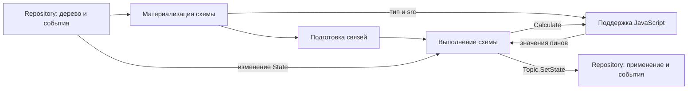

# Logram

Logram исполняет визуальные схемы автоматизации на сервере: связывает значения топиков, вызывает JavaScript-классы блоков и публикует результаты в Repository. Редактирование схемы относится к [WebUI](../WebUI/WebUI.md), а не к этому плагину. Компиляция и загрузка программ физических контроллеров также не входят в его ответственность.

## Ответственность и контракт модуля

| Участник | Взаимодействие с Logram |
|---|---|
| [Repository](../../Server/Repository/Repository.md) | Предоставляет дерево, State, Manifest и события. Получает команды изменения State и полей; применяет их на своём тике. |
| [WebUI](../WebUI/WebUI.md) | Создаёт топики блоков, пины и привязки, меняет значения и отображает результат через Repository. Прямой команды «вычислить схему» не посылает. |
| [Сервер](../../Server/Server.md#движковый-поток-и-плагины) | Управляет жизненным циклом плагина и общим движковым потоком. Предоставляет среду NiL.JS через [JsExtLib](../../Server/JsExtLib.cs). |
| [Каталог типов](../../Server/Repository/base.xst) | Содержит исходники классов и описания пинов. Logram использует уже загруженные типовые топики, но сам каталог не импортирует. |
| [PersistentStorage](../PersistentStorage/PersistentStorage.md) | Восстанавливает и сохраняет дерево и состояния согласно атрибутам топиков. Logram корректирует режим сохранения некоторых переменных при подготовке связей, но сам базу данных не обслуживает. |
| [Archivist](../Archivist/Archivist.md#чтение-истории) | Предоставляет историю для `Arch.Query` через общую серверную точку доступа, а не через привязки схемы. |

Вычислительные объекты Logram живут в памяти и не являются дополнительными топиками. Внутренняя передача значения, применение нового State в Repository, сохранение на диск и обновление браузера — разные этапы, не одна атомарная операция.

## Настройки

### Настройки плагина

| Топик и значение | Начальное состояние | Назначение |
|---|---|---|
| State `/$YS/Logram` | `true`; при инициализации назначаются `Required`, `Readonly`, `Config` | Разрешает запуск плагина. Хост читает признак при запуске; изменение State не выполняет горячий Start/Stop. |
| State `/$YS/Logram/verbose` | `true` в Debug, `false` в Release; при инициализации `Required`, `DB` | Значение поддерживается подпиской, но в текущем исполнителе нет потребителей этого флага для дополнительных сообщений. |

Начальное значение подставляется, если существующий State не является Boolean. Уже заданные Boolean и атрибуты такого топика не переинициализируются. Реализация: [LogramPl.enabled, Start](LogramPl.cs), [JsExtLib.EnsureCfg](../../Server/JsExtLib.cs).

### Настройки топика

Формат `Logram.block`, `Logram.bind`, координат и Trace описан в
[справочнике полей](../../Server/Repository/TopicFields.md#logram).
Общие `type` и `attr` — в [общих полях Manifest](../../Server/Repository/TopicFields.md#общие-поля-manifest).
Влияние связей на сохранение остаётся частью [подготовки связей](#подготовка-связей).

## Описание типа

Описание перенесено в [справочник полей Topic](../../Server/Repository/TopicFields.md#типы-блоков-logram).
Правила создания экземпляров остаются у [WebUI](../WebUI/WebUI.md#создание-блока-на-диаграмме).

### Топик описания и тип экземпляра

См. [описание и экземпляр блока](../../Server/Repository/TopicFields.md#топик-описания-и-тип-экземпляра).

### Поля State блока

См. [поля State блока](../../Server/Repository/TopicFields.md#поля-state-блока).

### Описание дочернего топика и пина

См. [шаблоны детей, `ddr` и служебные топики блока](../../Server/Repository/TopicFields.md#описание-дочернего-топика-и-пина).

### Пример State описания NOT

См. [пример NOT](../../Server/Repository/TopicFields.md#пример-state-описания-not).

## Механизмы

Общие механизмы — хранение и события [Repository](../../Server/Repository/Repository.md),
[создание по описанию в WebUI](../WebUI/WebUI.md#создание-топика-по-описанию)
и серверная JavaScript-среда — не дублируются как части исполнителя.
Ниже показаны собственные процессы Logram; раздел поддержки JavaScript
описывает привязку общей среды к конкретному блоку.

### Материализация схемы

**Задача.** Превратить описанные топиками блоки и переменные в объекты, с которыми может работать исполнитель.

**Контракт.** При Start плагин регистрирует глобальную подписку на Repository и один раз обходит существующее дерево. Это нужно для топиков, восстановленных до его запуска: подписка не воспроизводит их прошлые события. Если PersistentStorage включён, его Start выполняется раньше Start Logram; все Init при этом уже завершены.

После запуска события создания и изменения полей позволяют распознать новые объекты по [описанию схемы](../../Server/Repository/TopicFields.md#типы-блоков-logram). Пины и топики-источники также могут получить внутреннюю переменную по мере обращения к ним, без собственного признака `Logram.bind`. Новый дочерний топик подключается к уже известному родительскому блоку.

Удаление топика передаётся на подготовительную фазу. Stop снимает подписки и очищает очереди и реестр; ограничения освобождения JavaScript-контекстов указаны в [поддержке JavaScript](#поддержка-javascript).

**Границы.** Повторное распознавание сохраняет уже созданный объект. Удаление признака или смена типа не являются универсальным переключением между блоком и переменной. Появление ранее отсутствовавшего типа или источника не запускает повторный обход всех зависимых экземпляров. Плагин не обрабатывает перемещение топиков и не переписывает пути в `Logram.bind`; сохранившуюся связь в памяти нельзя считать гарантией её восстановления после перезапуска.

**Реализация.** [LogramPl.Start, Claim, Names, GetVariable, SubFunc, Stop](LogramPl.cs), [LoBlock.GetPin](LoBlock.cs); порядок запуска — [Program.InitPlugins, StartPlugins](../../Server/Program.cs).

**Проверки.** Прямых тестов начального обхода, распознавания по типу, добавления пинов и жизненного цикла объектов Logram в текущем наборе нет.

### Подготовка связей

**Задача.** Подключить источники и потребителей, подготовить порядок вычислений и определить, какие значения требуют самостоятельного сохранения.

**Контракт.** На первой фазе тика применяются ожидающие изменения источников, пересчитываются слои и маршруты зависимостей. У переменной может быть один источник и несколько потребителей; блок объединяет входные зависимости и служит источником собственных выходов. При удалении переменной отсоединяются связанные блоки и очищаются привязки зависящих от неё переменных.

При пересчёте связи действуют следующие правила сохранения:

- У переменной с источником-другой переменной снимается режим `DB`, если она сама не входит в кольцо источников. Это производное значение; режим `Config` данная проверка не снимает.
- Выход блока и переменная внутри кольца не теряют `DB` по этому правилу: они могут содержать самостоятельное состояние. Снятие `DB` означало бы не только прекращение записи, но и удаление ранее сохранённого State при обработке изменения [PersistentStorage](../PersistentStorage/PersistentStorage.md).
- При переходе к отсутствующему источнику живому топику назначается `DB`. Это переход уже существующей связи, а не обещание назначить `DB` каждой изначально несвязанной переменной.

Кольцо переменных — штатный случай: [LogramViewProvider.ExecuteAddVariable](../WebUI/Views/Logram/LogramViewProvider.cs) при переносе топика на диаграмму может создать встречную привязку исходного топика. Проверка принадлежности кольцу учитывает ожидающие источники, чтобы результат не зависел от порядка подготовки переменных.

**Границы.** Это не постоянная нормализация всех атрибутов на каждом тике. Кольцо переменных для правил сохранения и обратная связь через вычислительный блок — разные случаи. Для обратной связи используются маршрут и отрицательный слой; это не проверка сходимости произвольного графа и не запрет циклов.

**Реализация.** [LoVariable.ManifestChanged, Source, Tick1, SourceRingContainsSelf](LoVariable.cs), [LoBlock.GetPin, Tick1](LoBlock.cs), [LogramPl.EnqueueIn, Tick](LogramPl.cs).

**Проверки.** Прямых тестов перепривязки, колец, обратных связей и сохранения состояния выходов Logram нет. [TopicStateFieldTests.SetAttribute_DbAndConfigAreMutuallyExclusive](../../Tests/Repository/TopicStateFieldTests.cs) проверяет только общее правило атрибутов Repository.

### Выполнение схемы

**Задача.** Распространить изменение по внутренним зависимостям и передать новые состояния остальной системе.

**Контракт.** После подготовки исполнитель обрабатывает задания, упорядоченные по слою и пути топика. Изменение переменной передаётся её потребителям напрямую; не требуется ждать отдельного события Repository на каждом звене цепочки. Задание, которое уже нельзя включить в текущий проход, переносится на следующую подготовительную фазу.

Блок запоминает последнюю причину изменения и при её наличии вызывает `Calculate`. Для собственного пина аргументом служит его имя, для внешнего топика — абсолютный путь. Несколько изменений до вызова могут объединиться: это не очередь отдельных вызовов на каждое событие входа.

Переменная хранит текущее и ожидающее значения. На второй фазе она принимает ожидающее значение, вызывает `Topic.SetState` с запомненным автором и передаёт значение внутренним потребителям, указывая уже собственный топик как причину.

**Границы.** Вызов `Topic.SetState` ещё не означает применение State в Repository: оно произойдёт на его тике согласно [общему контракту](../../Server/Repository/Repository.md). Завершение прохода Logram не обещает сходимость любой схемы за один тик, доставку каждого промежуточного значения или немедленное обновление браузера. Исключения при подготовке и вычислении журналируются; отката уже сделанных изменений нет.

**Реализация.** [LogramPl.Tick, EnqueuePr, SubFunc](LogramPl.cs), [LoVariable.SetValue, Tick2, CompareTo](LoVariable.cs), [LoBlock.SetValue, Tick2, CompareTo](LoBlock.cs), общий интерфейс фаз — [ILoItem](ILoItem.cs).

**Проверки.** Прямых тестов планировщика и распространения значений Logram нет. [TopicStateFieldTests.SetState_IsAppliedOnTheTick, SetState_TwiceInOneTickKeepsTheLastValue, SetState_RepeatedValueIsNotAnEvent](../../Tests/Repository/TopicStateFieldTests.cs) проверяют границу Repository, но не исполнение схемы.

### Поддержка JavaScript

**Задача.** Выполнить класс блока в общей серверной среде, предоставив ему доступ к значениям, полям и отложенным действиям.

**Контракт.** Блок получает отдельный контекст на основе `JsExtLib.Context`. Вычисление `src` должно дать JavaScript-класс, требующий `new`; создаётся его экземпляр и извлекается функция `Calculate`. Обычная функция вместо класса не подходит. В прототип добавляются средства доступа к топикам и `path` — путь владельца на момент создания экземпляра.

| Средство блока | Граница доступа |
|---|---|
| `GetState` | Читает внутреннее значение переменной по пути от блока или абсолютному пути; для существующего внешнего топика создаёт входную зависимость. До первой публикации возвращается начальное ожидающее значение. Отсутствующий топик даёт `NotExists`. |
| `SetState` | Передаёт значение внутренней переменной только для прямого дочернего топика живого блока. Путь может создать топик; проверка родителя выполняется после создания, поэтому это не средство записи State произвольного внешнего топика. |
| `GetField`, `SetField` | Читают и меняют Manifest существующего топика. Путь топика и путь поля передаются отдельно. Запись требует живого блока и непустого пути топика, выполняется через Repository с блоком в качестве автора. |
| `setTimeout`, `setInterval`, `setAlarm` | Регистрируют таймеры общей среды с контекстом блока как владельцем. Для повторения интервала нужен положительный период; `setAlarm` принимает JavaScript Date и задаёт ежедневное время суток. |

Общие правила [контекста и таймеров](../../Server/Server.md#контекст-и-таймеры),
а также ограничения [внешних операций JavaScript](../../Server/Server.md#внешние-операции-javascript)
описаны у сервера. Они включают отмену таймеров, `XMLHttpRequest`, `console`,
`File.AppendText` и `Arch.Query`, но не обещают полностью неблокирующего
ввода-вывода или возврата всех асинхронных продолжений на движковый поток.
Контракт результата и ошибки чтения архива остаются у
[Archivist](../Archivist/Archivist.md#чтение-истории).

**Границы.**

- Перекомпиляция привязана к смене объекта типового топика. Редактирование `src` того же типа само по себе не перезагружает существующие блоки и не перестраивает уже подключённые пины.
- Ошибки конструктора и `Calculate` попадают в журнал, однако неудачная пересборка не гарантирует очистку прежнего исполняемого состояния. Отсутствующий `Calculate` оставляет блок без вызовов вычисления, без отдельной диагностики этого случая.
- При обработке удаления блока отменяются таймеры его текущего контекста. Смена типа не отменяет таймеры предыдущего контекста, а Stop плагина не выполняет такое завершение для каждого блока. Нельзя обещать полную очистку всех связанных асинхронных операций.
- Скрипт разделяет движковый поток с остальными модулями; длительный вызов задерживает сервер. `/$YS/Performance/Script` измеряет успешно завершившиеся callback таймеров в `JsExtLib.Tick`, а не все конструкторы и вызовы `Calculate`. Это не ограничитель времени выполнения.

**Реализация.** [LoBlock.ManifestChanged, Tick1, Tick2, GetState, SetState, GetField, SetField, SetTimeout, SetInterval, SetAlarm](LoBlock.cs), [JsExtLib.ActivateEngineOnThisThread, SetTimer, ClearTimeout, Post, Tick, TakeMaxCallbackMs](../../Server/JsExtLib.cs).

**Проверки.** Прямых тестов компиляции классов Logram, их JavaScript-интерфейса, замены типа и освобождения контекстных таймеров нет.

## Сценарий: импульс увеличивает сохранённый счётчик

Исходная схема использует реальный тип `LoBlock/Common/Counter` из [base.xst](../../Server/Repository/base.xst). Блок находится в `/Logic/Counter`; его вход `+1` привязан к `/Inputs/Pulse`, а `/Outputs/Count` — к выходу `/Logic/Counter/Q`. Для `Q` явно выбран режим `DB`, PersistentStorage восстановил значение `20`. Входы `Rst`, `Set`, `-1` и `+1` ложны; начальное распространение после запуска завершено.

1. При запуске [материализация схемы](#материализация-схемы) создаёт блок и переменные. [Поддержка JavaScript](#поддержка-javascript) вызывает конструктор Counter: он проверяет режим сохранения `Q` и не обнуляет восстановленное значение в режиме `DB`.
2. [Подготовка связей](#подготовка-связей) соединяет источник импульса, вход блока и потребителя результата. Сохранение собственного состояния выхода подчиняется правилам этого механизма.
3. Пользователь меняет State `/Inputs/Pulse` с `false` на `true` в [Inspector WebUI](../WebUI/WebUI.md). Подтверждение запроса ещё не означает вычисление: сначала [Repository](../../Server/Repository/Repository.md) применяет новое состояние и публикует событие.
4. [Выполнение схемы](#выполнение-схемы) передаёт изменение входу `+1`. При вызове `Calculate` с этой причиной Counter увеличивает внутреннее значение `Q` до `21` через интерфейс блока.
5. То же [выполнение схемы](#выполнение-схемы) передаёт значение потребителю и ставит изменения State в Repository. Число необходимых проходов не является обещанием сценария.
6. Repository применяет результаты; WebUI обновляет представление, а [PersistentStorage](../PersistentStorage/PersistentStorage.md) отдельно сохраняет состояние `Q`. Публикация результата и его запись на диск не являются одним подтверждением.

Для следующего импульса вход должен сначала вернуться в `false`: повторная запись того же State не является новым событием Repository. Сквозного автоматического теста этого сценария пока нет.

## Проверки и пробелы

Набор [LogramTraceTests](../../Tests/WebUI/LogramTraceTests.cs) проверяет представление лограммы: снимок и обновление метки переменной, сохранение метки при переносе, переключение Trace и меню. Он использует настоящий контроллер WebUI, но **не запускает LogramPl** и не подтверждает работу вычислительного графа или сохранность связей при изменении координат.

Общие проверки Repository указаны у соответствующих механизмов. Каталожный Counter служит примером исполняемого контракта, а не тестом. Основные пробелы — начальный обход, динамическая перепривязка, порядок фаз, объединение причин, кольца и режимы сохранения, ошибки JavaScript и завершение блоков.

## Уточнения прежнего описания

- Подписка плагина глобальная, а отбор интересующих полей выполняется в обработчике; это не отдельные подписки на поля каждого экземпляра.
- Восстановление PersistentStorage предшествует Start Logram, но не его Init. Наличие каталога типов не определяется одним лишь включением PersistentStorage.
- Послойное выполнение не равно гарантии сходимости за один тик, а внутреннее значение переменной не равно уже применённому State Repository.
- Возврат через очередь уточнён для таймеров и ответа XMLHttpRequest; показатель `Performance/Script` не объявляется измерителем всех вызовов JavaScript.

При изменении поведения обновляется карточка соответствующего механизма и его проверки. Сигнатуры и детали алгоритмов остаются в исходниках, формат топиков — в общих документах Repository и сервера.

---

[Вернуться к основному README](../../README.md)
