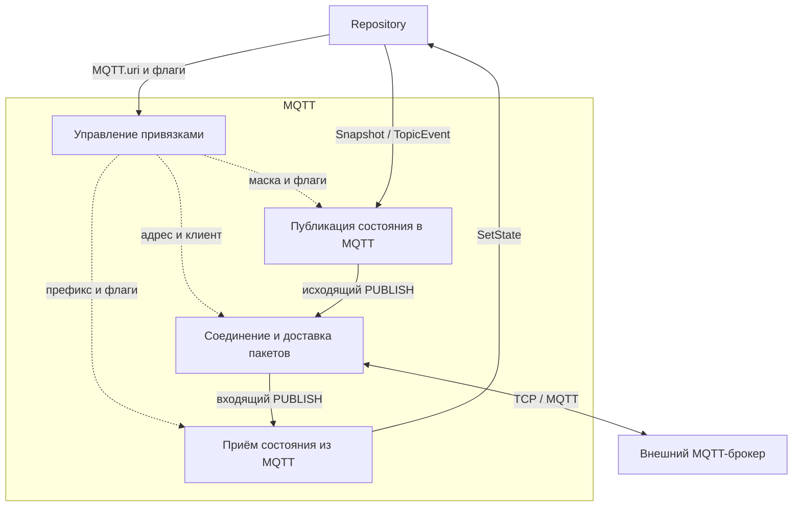

# MQTT

MQTT связывает состояния топиков Enviriot с топиками внешнего MQTT-брокера.
Внешняя система может передать значение в Repository, а изменения из браузера
или лограммы — уйти брокеру. Два направления включаются отдельно.

Это область обмена с внешними системами в [общей архитектуре](../../README.md#как-это-работает).
Плагин является клиентом брокера.

Навигация: [контракт](#ответственность-и-контракт-модуля),
[настройки](#настройки), [адреса и значения](#адреса-фильтры-и-значения),
[механизмы](#механизмы), [сквозной сценарий](#сценарий-обмен-значением-с-внешней-системой),
[проверки](#проверки-и-пробелы), [уточнения](#уточнения-прежнего-описания).

## Ответственность и контракт модуля

| Участник | Ответственность |
|---|---|
| [Repository](../../Server/Repository/Repository.md) | Хранит Topic, State и Manifest, применяет команды на тике и доставляет события подписчикам. Общие понятия определены в его документе. |
| MQTT | Читает настройки привязок, поддерживает TCP-клиентов, сопоставляет темы и топики, преобразует JSON и передаёт значения в обоих направлениях. |
| Внешний брокер | Принимает соединения и публикации, обслуживает подписки и retained-сообщения. Его права доступа и хранение не настраиваются этим плагином. |

Входы модуля — настройки `MQTT` в манифестах, события Repository и пакеты
брокера. Выходы — команды `SetState`, исходящие пакеты и диагностические
состояния соединений.

**Привязка, установленное соединение, отправленный пакет и применённый State —
разные результаты.** Статус `Connected` означает принятый `CONNACK`,
но не успешность каждой подписки. Возврат из `Send` не подтверждает доставку,
а MQTT-подтверждение входящего пакета не подтверждает применение State.

## Настройки

### Настройки плагина

| Где | Смысл |
|---|---|
| State `/$YS/MQTT` | Включение плагина при запуске. Если значение не Boolean, задаются `true` и атрибуты `Required`, `Readonly`, `Config`. |
| State `/$YS/MQTT/verbose` | Диагностика, по умолчанию `false`. Настройка поддерживается подпиской и имеет атрибуты `Required`, `DB`. В журнал могут попадать темы и содержимое сообщений. |

`/$YS/MQTT/Connections/<host>` — **выход диагностики**, не настройка.
Он содержит строку состояния клиента и помечается `Readonly`.
Порт и имя пользователя в имя этого топика не входят: несколько клиентов
одного хоста могут перезаписывать его состояние.

Реализация: [MQTTPl.enabled, Start](MQTTPl.cs), [MqClient.status](MqClient.cs).

### Настройки топика

Формат `MQTT.uri`, `MQTT.subscribe`, `MQTT.publish`, `MQTT.retained`
и значения по умолчанию — в [справочнике полей Topic](../../Server/Repository/TopicFields.md#mqtt).
Здесь описано применение настроек владельца привязки.

Три флага читаются при создании привязки и **обновляются подпиской на манифест**.
Нормализация типов по правилам справочника выполняется как при создании,
так и при последующих изменениях.

После применения манифеста Repository новые настройки действуют без
пересоздания привязки и переподключения TCP-клиента:

- `MQTT.subscribe=false` прекращает приём в эту привязку и снимает подписку
  у брокера, если тот же фильтр не нужен другой активной привязке клиента.
  `true` включает подписку при доступном соединении; при начальной синхронизации
  сохраняется порядок «локальный снимок — Ready — подписка брокеру».
- `MQTT.publish=false` снимает подписку на значения Repository, не отключая
  приём. Возврат к `true` создаёт подписку заново с новым снимком текущих
  значений; снимок доставляется на тике Repository.
- `MQTT.retained` изменяет флаг следующих публикаций, не пересоздавая подписки
  и не удаляя ранее сохранённое брокером retained-сообщение.

При отсутствии соединения подписка на настройки остаётся активной.
После подключения используются текущие флаги. Повтор прежнего значения,
изменение соседнего поля и изменение одного `retained` не вызывают лишних
`SUBSCRIBE`/`UNSUBSCRIBE`. Замена всей ветви `MQTT` также учитывается.

Реализация: [MQTTPl.SubFunc](MQTTPl.cs);
[MqSite.ReadFlag, SettingsChanged, RefreshSettings, UpdateSubscriptions](MqSite.cs).

## Адреса, фильтры и значения

Это общие правила двух направлений обмена, а не отдельный механизм.

**URI и транспорт.** В конфигурации следует использовать
`mqtt://[user:password@]host[:port]/filter`; без явного порта выбирается 1883.
Транспорт — обычный TCP, без TLS. Код проверяет абсолютность URI, но не
ограничивает его схему: запись `mqtts://` сама по себе шифрование не включает.
Имя и пароль из URI передаются в `CONNECT`.

Внешний путь собирается из `PathAndQuery` и `Fragment`: `#` восстанавливается
из фрагмента URI, а query-часть не является набором параметров плагина.
На брокер передаются фильтры и темы с начальным `/`; внешнему клиенту нужно
использовать те же имена.

**Привязка путей.** `remotePrefix` состоит из сегментов до первого `+` или `#`.
При публикации к нему добавляется путь относительно владельца; при приёме
этот префикс снимается и оставшийся путь разрешается под владельцем.
Например, для владельца `/bridge/room` и URI
`mqtt://broker.example/house/room/#` тема `/house/room/T` соответствует
локальному топику `/bridge/room/T`.

| Окончание внешнего пути | Локальная область публикации |
|---|---|
| `/#` | Владелец и всё его поддерево: маска `All`. |
| `/+` | Непосредственные дети, без владельца: маска `Children`. |
| Без wildcard | Только владелец, без его детей: маска `Once | Value`. Передаются начальный снимок и последующие изменения его State. |

Это не полная реализация произвольных фильтров MQTT. Брокеру отправляется
исходный фильтр, но локальная область определяется первым wildcard.
При маршрутизации входящих сообщений клиент использует строковый
`StartsWith(remotePrefix)`, без проверки границы сегмента и полного фильтра.
Поэтому похожие и перекрывающиеся префиксы могут направить сообщение в несколько
привязок; обычную схему с одним конечным `+` или `#` нельзя обобщать на все фильтры.

**Значения.** Полезная нагрузка — UTF-8 с JSON, а не произвольный текст
или двоичный поток. Число `21` передаётся как JSON-число, строка `"on"` —
с JSON-кавычками; просто `on` не является корректным JSON.
Преобразования выполняются через [JsLib.ParseJson, Stringify](../../Server/JsLib.cs),
включая общие правила специальных значений Enviriot.

Формат MQTT-пакетов, длины и флаги остаются в [MqMessages.cs](MqMessages.cs).
Сопоставление путей находится в [MqSite](MqSite.cs) и
[MqClient.ProccessPublishMsg](MqClient.cs).

## Механизмы

Четыре узла внутри MQTT соответствуют четырём одноимённым разделам ниже.
Сплошные стрелки показывают данные, пунктирные — настройку участников.

### Управление привязками

**Задача.** Поддерживать соответствие между настройками манифестов и
объектами обмена, не смешивая привязку с сетевым соединением.

**Контракт.** При запуске плагин с приоритетом 8 подписывается на поле
`MQTT.uri` во всём дереве. Начальные `Snapshot` позволяют обнаружить уже
настроенные топики. При изменении поля прежний `MqSite` освобождается,
затем URI разбирается и создаётся новый объект привязки.
Неизменившееся значение отсекает Repository, а не сравнение внутри MQTT.

`MqSite` связывает одного владельца с внешним фильтром; `MqClient` обслуживает
TCP-соединение и список таких привязок. Плагин ищет клиента по сигнатуре из
имени пользователя, хоста и порта. Пароль не входит в сигнатуру.
В `Action` владельца добавляется действие `MQTT.Reconnect`, которое передаёт
клиенту запрос перезапуска через пул потоков. Перезапуск общего клиента
затрагивает все его привязки.

Отключение приёма не удаляет привязку из клиента: она продолжает наблюдать
настройки и может включить приём снова. Одинаковый внешний фильтр нескольких
привязок обслуживается одной подпиской брокеру до отключения последнего
потребителя.

При остановке плагина освобождаются все привязки, включая их подписки на настройки,
снимаются подписки плагина и вызывается `Dispose` клиентов. Привязка удаляется
из клиента независимо от значения `MQTT.subscribe`.
Исчезновение привязки не означает удаление сохранённых брокером сообщений.

**Границы и ошибки.**

- Смена пароля при прежней сигнатуре может повторно использовать клиента
  со старыми учётными данными. Кроме того, явный `:1883` формирует в плагине
  сигнатуру, отличную от сигнатуры клиента; такой URI может создавать лишних клиентов.
- Перемещение владельца освобождает найденную привязку, но ветка обработки
  перемещения её не создаёт заново.

**Реализация.** [MQTTPl.Init, Start, SubFunc, ReconnectRpc, Stop](MQTTPl.cs);
[MqSite](MqSite.cs), [MqClient.Signature, Sites](MqClient.cs).

**Проверки.** Фильтр поля, снимки и подавление повторной записи проверяются
в Repository. Динамические флаги, общий фильтр, освобождение привязок и
остановка плагина проверяются в [MqSiteTests](../../Tests/MQTT/MqSiteTests.cs).
См. [матрицу проверок](#проверки-и-пробелы).

### Соединение и доставка пакетов

**Задача.** Установить сессию с брокером, передавать пакеты и обнаруживать
потерю связи.

**Контракт.** Клиент начинает асинхронное TCP-подключение, посылает `CONNECT`
и ожидает `CONNACK`. Текущий путь подключения использует MQTT 3.1,
`cleanSession=true` и идентификатор из имени машины и PID процесса.

| Состояние | Значение |
|---|---|
| `Disconnected` | Клиент не считает соединение установленным. |
| `Connecting` | Начато подключение; принятого `CONNACK` ещё нет. |
| `Connected` | Брокер принял `CONNECT`; привязки получают уведомление. |
| `NotAccepted` | Отказ брокера либо ошибка подключения, для которой остановлены автоматические попытки. |

Таймер клиента обслуживает ожидание подключения, `PINGREQ`/`PINGRESP` и
повторные попытки. После обычного разрыва привязки снимают подписки на
Repository; при восстановлении они подключаются заново.

`MqStreamer` собирает входящие пакеты из TCP-потока и последовательно
передаёт их клиенту. Исходящие пакеты сериализуются и отправляются асинхронно;
при занятом отправителе используется очередь в памяти. Для пакетов,
поставленных на ожидание подтверждения, предусмотрены ограниченные повторы.
Переход отправителя в свободное состояние согласован с постановкой в очередь:
пакет, пришедший одновременно с завершением предыдущей записи, не должен
оставаться без запуска отправки.

**Границы.** Публикации привязок и запрашиваемый уровень входящей подписки —
QoS 0. Наличие классов `PUBACK`, `PUBREC`, `PUBREL`, `PUBCOMP` не обещает
пользователю полноценную доставку «ровно один раз»: входящие публикации
не дедуплицируются этим механизмом. Состояние `Connected` не учитывает
результат каждого `SUBACK`.

Очереди не сохраняются на диск, а завершение асинхронной записи не является
подтверждением обработки брокером. Частично принятый пакет может быть сброшен
таймером приёма.

Ошибки подключения журналируются; часть сетевых ошибок приводит к новой
попытке, часть — к `NotAccepted`. Команда Reconnect обрабатывает
`Connected` и `Disconnected`, но **не выводит клиента из `NotAccepted`**.
Её нельзя считать гарантированным сбросом любого отказа.

**Реализация.** [MqClient.Connect, ConnectCB, Received, TimeOut, Restart](MqClient.cs);
[MqStreamer.Send, RcvProcess, SendWaitAck](MqStreamer.cs);
[MqConnect, MqMessage.Parse, Serialise](MqMessages.cs).

**Проверки.** [MqSiteTests](../../Tests/MQTT/MqSiteTests.cs) используют настоящее
TCP-соединение с локальным имитатором брокера, включая повторное подключение
и остановку. 

### Приём состояния из MQTT

**Задача.** Превратить публикацию внешней системы в изменение локального State.

**Контракт.** Клиент получает `PUBLISH`, при необходимости добавляет начальный
`/` к его теме и выбирает привязки по префиксу.
При включённом `MQTT.subscribe` привязка разбирает JSON, разрешает локальный
путь и при необходимости создаёт топик. Для топика без атрибута `Internal`
вызывается `SetState` с владельцем привязки в качестве автора.
Правила путей и представления данных описаны [выше](#адреса-фильтры-и-значения).

Значение становится State только при обработке команды Repository.
Если входящий пакет требует MQTT-подтверждения, клиент отправляет его
до обработки полезной нагрузки привязкой: это не квитанция о применении State.

**Границы и ошибки.** Неверный JSON или ошибка разрешения пути не превращаются
в изменение состояния; предупреждение этой ветки пишется только при `verbose`.
Пустая полезная нагрузка не является командой удаления локального топика.
Входящий retained-флаг не задаёт атрибуты хранения Repository.

Автор изменения позволяет подавить немедленную обратную публикацию
той же привязкой. Это не общая защита от циклов между несколькими привязками
или другими участниками системы.

**Реализация.** [MqClient.Received, ProccessPublishMsg](MqClient.cs);
[MqSite.Publish](MqSite.cs); [Topic.SetState](../../Server/Repository/Topic.cs).

**Проверки.** Отложенное применение State проверяется в Repository.
Переключение приёма и автор изменения проверяются вызовом `MqSite.Publish`
в [SubscribeFlag_TogglesBrokerSubscriptionAndIncomingValues](../../Tests/MQTT/MqSiteTests.cs).
Произвольные префиксы, форматы JSON, `Internal` и полный маршрут обратного эха
не покрыты; [матрица проверок](#проверки-и-пробелы).

### Публикация состояния в MQTT

**Задача.** Передать брокеру текущие значения и последующие локальные изменения.

**Контракт.** При установленном соединении и включённом `MQTT.publish`
привязка создаёт подписку на Repository с областью из внешнего фильтра.
Она публикует начальные `Snapshot`, а затем `StateChanged` и `Created`,
если автор изменения отличается от владельца привязки.
Топики с атрибутом `Internal` пропускаются.
State сериализуется в JSON и передаётся клиенту как `PUBLISH` с настроенным
retained-флагом.

При первоначальном подключении двух включённых направлений порядок такой: локальный снимок,
событие `Ready`, затем отправка `SUBSCRIBE` брокеру. Если публикация выключена,
подписка брокеру отправляется сразу после подключения.
Это не политика «сначала восстановить значения из брокера»: локальные значения
могут быть опубликованы раньше получения внешних retained-сообщений.
Если приём уже включён, включение публикации не прерывает существующую
подписку брокеру ради нового локального снимка.

**Границы.** Repository объединяет изменения внутри тика; плагин читает текущий State
источника, а не журнал всех промежуточных значений.
Во время отключения история изменений не накапливается для последующей
доставки; после подключения используется новый снимок текущего дерева.

Удаление и перемещение топика не переводятся в команды очистки тем брокера.
В частности, удаление локального топика не удаляет автоматически его
retained-сообщение. Подписка и публикация не имеют отдельного ответа об успехе
для браузера или лограммы.

**Реализация.** [MqSite.Connected, Changed, Disconnected](MqSite.cs);
[MqClient.Send](MqClient.cs), [MqPublish](MqMessages.cs).

**Проверки.** Области снимка и порядок событий проверяются в Repository.
Пакеты публикаций точного топика, областей `+`/`#`, смена `retained` и
переключение публикации проверяются в [MqSiteTests](../../Tests/MQTT/MqSiteTests.cs);
[пробелы](#проверки-и-пробелы).

## Сценарий: обмен значением с внешней системой

Владелец `/bridge/room` имеет URI `mqtt://broker.example/house/room/#`,
оба направления включены. Соединение принято брокером, начальная синхронизация
закончена, `/bridge/room/T` не имеет атрибута `Internal`.
Внешний клиент имеет необходимые права у брокера.

| Шаг | Переход и наблюдаемый результат |
|---|---|
| 1. Пользователь или лограмма задаёт 21 | [Topic.SetState](../../Server/Repository/Topic.cs) ставит команду. Правило отложенной записи принадлежит [Repository](../../Server/Repository/Repository.md#очередь-изменений-и-тик-repository). |
| 2. Repository применяет State | [Repo.Tick](../../Server/Repository/Repo.cs) публикует `StateChanged`; [механизм публикации](#публикация-состояния-в-mqtt) получает событие. |
| 3. MQTT передаёт значение | Формируется тема `/house/room/T` и JSON `21`. [Механизм доставки](#соединение-и-доставка-пакетов) отправляет пакет; завершение локальной отправки не доказывает получение внешним клиентом. |
| 4. Внешняя система публикует 22 | Брокер передаёт `PUBLISH` по подписке. [Механизм приёма](#приём-состояния-из-mqtt) сопоставляет путь и ставит `SetState(22)` с автором — владельцем привязки. |
| 5. Repository применяет обратное изменение | State становится 22 на тике, событие доступно остальным подписчикам. Та же MQTT-привязка не публикует это изменение обратно из-за совпадения автора. |

## Проверки и пробелы

Проверки Repository дополнены [MqSiteTests](../../Tests/MQTT/MqSiteTests.cs):
настоящий TCP-клиент соединяется с локальным `TcpListener` на свободном порту,
а тест читает и подтверждает его MQTT-пакеты. Внешний брокер не требуется.
При исправлении динамических флагов выполнены Debug-сборка и выборочный
прогон NUnit для MQTT и связанных подписок Repository; они завершились успешно.
Это не испытание совместимости с конкретным внешним брокером.

| Правило | Существующая проверка или пробел |
|---|---|
| Повтор того же поля не создаёт событие | [TopicStateFieldTests.SetField_TheSameValueIsNotAChange](../../Tests/Repository/TopicStateFieldTests.cs). Не проверяет отсутствие сетевого переподключения. |
| Изменение соседнего поля не затрагивает подписку на `MQTT.uri` | [RepoDeliveryTests.Deliver_AWriteThatLeavesThePrefixAloneDoesNotReachIt](../../Tests/Repository/RepoDeliveryTests.cs). |
| Начальный снимок фильтруется по полю | [RepoSubscriptionTests.Subscribe_FieldWithAPrefixSkipsTopicsWithoutThatField](../../Tests/Repository/RepoSubscriptionTests.cs). |
| Области `Children` и `All` различаются | [RepoSubscriptionTests.Subscribe_ChildrenSnapshotsTheChildrenButNotTheTopic, Subscribe_AllSnapshotsTheWholeSubtreeIncludingTheTopic](../../Tests/Repository/RepoSubscriptionTests.cs). |
| Снимок и изменения предшествуют `Ready` в проверяемом тике | [RepoSubscriptionTests.Subscribe_TheSnapshotPrecedesChangesMadeInTheSameTick](../../Tests/Repository/RepoSubscriptionTests.cs). Не проверяет порядок пакетов на брокере. |
| State применяется на тике | [TopicStateFieldTests.SetState_IsAppliedOnTheTick](../../Tests/Repository/TopicStateFieldTests.cs). |
| Точный топик и прежние области `+`/`#` | [MqSiteTests.ExactTopic_PublishesOwnerSnapshotAndChangesOnly, Wildcards_PreserveTheirLocalScope](../../Tests/MQTT/MqSiteTests.cs). |
| Переключение приёма и публикации без пересоздания привязки | [MqSiteTests.SubscribeFlag_TogglesBrokerSubscriptionAndIncomingValues, PublishFlag_RestartsSnapshotWithoutResubscribingBroker, DisablingSubscribe_DoesNotDisablePublishing](../../Tests/MQTT/MqSiteTests.cs). |
| Retained следующей публикации и согласованная замена ветви `MQTT` | [MqSiteTests.RetainedFlag_AffectsTheNextPublicationWithoutResubscribing, WholeMqttField_AppliesAllFlagsTogether](../../Tests/MQTT/MqSiteTests.cs). |
| Смена флагов при ещё не доставленном снимке или `Ready` | [MqSiteTests.PendingSnapshot_UsesTheLatestPublishFlag, SubscribeFlag_ChangedBeforeReadyDoesNotSendAStaleSubscription](../../Tests/MQTT/MqSiteTests.cs). |
| Актуальные настройки после восстановления соединения | [MqSiteTests.OfflineFlagChanges_AreUsedOnReconnect](../../Tests/MQTT/MqSiteTests.cs). |
| Общий фильтр живёт до отключения последней привязки | [MqSiteTests.SharedFilter_IsUnsubscribedOnlyWhenTheLastSiteDisablesIt](../../Tests/MQTT/MqSiteTests.cs). |
| Пакет не теряет запуск при переходе отправителя в свободное состояние | [MqStreamerTests.Send_DoesNotLeaveAMessageBehindWhenTheWriterBecomesIdle](../../Tests/MQTT/MqStreamerTests.cs), управляемое чередование потоков и настоящие TCP-записи. |
| Значения по умолчанию и отсутствие лишних переподписок | [MqSiteTests.NonBooleanFlags_AreResetToDefaultsWhileRunning, UnchangedFlagsAndUnrelatedFields_DoNotChurnSubscriptions](../../Tests/MQTT/MqSiteTests.cs). |
| Освобождение привязки и её подписки на флаги | [MqSiteTests.Dispose_RemovesTheSiteAndStopsWatchingFlags, PluginStop_DisposesTheFlagSubscription](../../Tests/MQTT/MqSiteTests.cs). |
| Произвольные URI, повторное использование клиентов по сигнатуре, RPC-действие Reconnect | Отдельных проверок нет. |
| Произвольные префиксы, ошибочный JSON, `Internal`, полный маршрут обратного эха | Отдельных проверок нет. |
| Полная сериализация MQTT, QoS 1/2, отказ подключения, таймауты и повреждённые пакеты | Тесты привязок не являются полным покрытием этих правил. |
| Полный маршрут Repository — брокер — Repository | Интеграционного теста в checkout нет. |

Проверка ссылок, символов и неизменности кода подтверждает качество навигации
и границы этой правки, но не работоспособность протокола или отсутствие
перечисленных ограничений.

---

[Вернуться к основному README](../../README.md)
