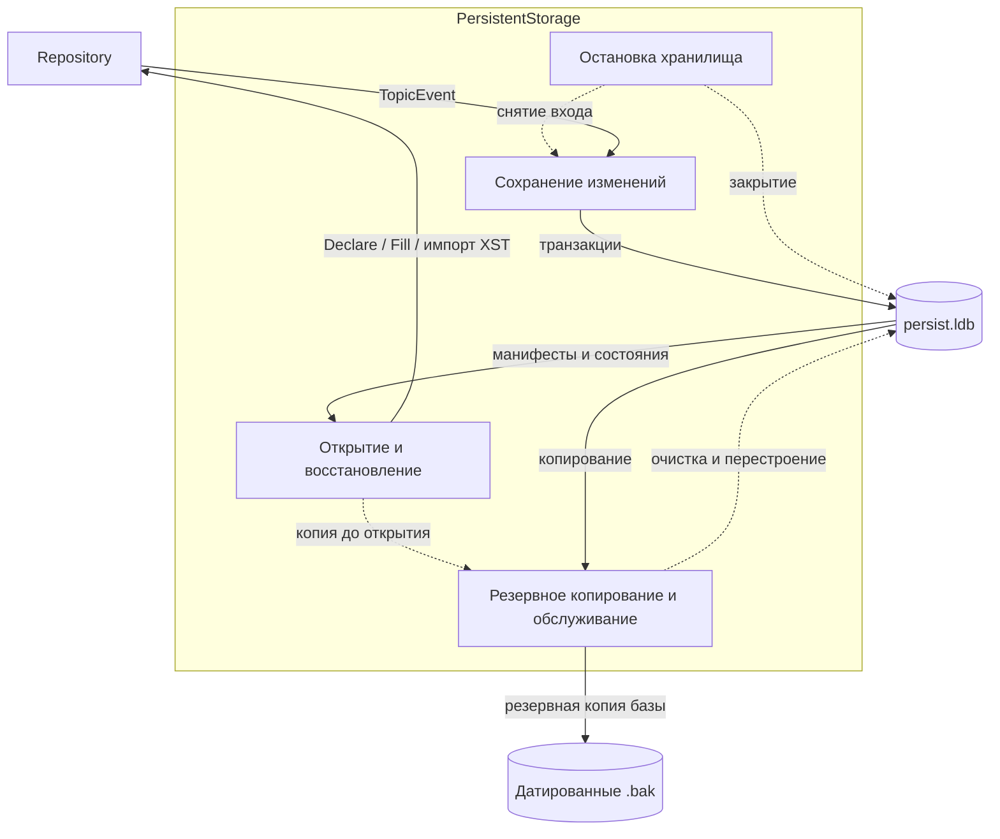

# PersistentStorage

PersistentStorage сохраняет манифесты и последние значения выбранных топиков,
чтобы восстановить их после перезапуска Enviriot. Историей сообщений процесса
владеет [серверный Log](../../Server/Server.md#файловая-история-журнала).

Это область долговременного хранения в [общей архитектуре](../../README.md#как-это-работает),
а не архив изменения показаний.

Навигация: [контракт](#ответственность-и-контракт-модуля),
[настройки](#настройки), [представление данных](#представление-данных),
[механизмы](#механизмы), [сквозной сценарий](#сценарий-сохранение-state-и-восстановление-после-перезапуска),
[проверки](#проверки-и-пробелы).

## Ответственность и контракт модуля

| Участник | Ответственность и граница |
|---|---|
| [Repository](../../Server/Repository/Repository.md) | Хранит текущее дерево, применяет команды и публикует события. Понятия Topic, State, Manifest и атрибутов определены в его документе. |
| PersistentStorage | Восстанавливает данные из LiteDB, сохраняет подходящие изменения и обслуживает резервные копии своей базы. |
| [Конфигурация XST](../../Server/Server.md#импорт-экспорт-и-конфигурация) | Импорт и сохранение конфигурационного файла принадлежат Repository и Xst. |
| [Archivist](../Archivist/Archivist.md) | Хранит последовательность числовых значений во времени. |
| [Log](../../Server/Server.md#файловая-история-журнала) | Самостоятельно пишет и читает файлы журнала. Его история не зависит от включения или резервного копирования PersistentStorage. |
| [Хост плагинов](../../Server/Server.md#движковый-поток-и-плагины) | Задаёт порядок `Init`, `Start`, `Tick`, `Stop` и обрабатывает отказ запуска. Имя экспорта этого плагина — `LiteDB`, приоритет — 2. |

Входы — опубликованные события Repository и настройки хранения.
Выходы — восстановленные топики, записи в `persist.ldb` и датированные копии базы.

**Применение State в Repository, попадание события в очередь плагина и
фиксация транзакции LiteDB — разные этапы.** Обновлённое значение в интерфейсе
не подтверждает сохранение на диск. Отдельной квитанции о долговременной
записи отправителю команды плагин не возвращает.

## Настройки

### Настройки плагина

| Где | Смысл |
|---|---|
| State `/$YS/PersistentStorage` | Включение при запуске. Если значение не Boolean, задаются `true` и атрибуты `Required`, `Readonly`, `Config`. |
| State `/$YS/PersistentStorage/bak` | Каталог резервных копий. Если топика нет, он создаётся с каталогом данных по умолчанию и атрибутами `Required`, `Readonly`, `Config`. |

Каталог резервных копий читается при подготовке каждой копии; переподключение подписки
для его изменения не требуется. Пустое или нестроковое значение даёт
предупреждение и подстановку каталога данных. Отсутствующий каталог создаётся,
но ошибка доступа не подменяется сообщением об успешной копии.
`Readonly` ограничивает редактирование State через IDE, а не запись из кода.

Путь рабочей базы задан константой `DB_PATH`: файл `persist.ldb` находится
в `data` на уровень выше рабочего каталога процесса. Это не отдельная
настройка в дереве. Путь `bak` также может быть относительным.

Реализация: [LiteDB_Pl.enabled, SeedBackupDir, BackupDir](LiteDB_Pl.cs).

### Настройки топика

Режимы `DB`/`Config`, маска `Saved` и формат `Manifest.version`
определены в [справочнике полей Topic](../../Server/Repository/TopicFields.md#общие-поля-manifest).
Выбор версии описан в [восстановлении](#открытие-и-восстановление),
а удаление сохранённого State при снятии `DB` — в [сохранении изменений](#сохранение-изменений).

Манифест обрабатывается независимо от `DB`: топик может быть сохранён и восстановлен без строки State. 

Реализация: [LiteDB_Pl.Load, Save](LiteDB_Pl.cs);
[Topic.SetAttribute](../../Server/Repository/Topic.cs).

## Представление данных

| Коллекция в `persist.ldb` | Назначение |
|---|---|
| `objects` | Пути и манифесты сохранённых топиков. По этой коллекции восстанавливается структура. |
| `states` | Последние сохраняемые состояния, связываются с манифестом через общий `ObjectId`. |

Соответствие живого Topic записи хранится по экземпляру, не по изменяемому
пути. Это сохраняет идентификатор при обработке переименования самого топика.
Ограничение переноса целого поддерева описано в
[механизме записи](#сохранение-изменений).

State и Manifest преобразуются между `JSValue` и BSON:

- массивы NiL.JS распознаются как в прямом, так и в обёрнутом представлении;
  объект с числовыми именами свойств не становится массивом;
- `ByteArray` сохраняется как двоичные данные, Date — как BSON DateTime
  с приведением к UTC при записи и местному времени при чтении;
- имена полей объектов проходят парные преобразования
  [EscapFieldName, UnescapFieldName](LiteDB_Pl.cs);
- строки сохраняются буквально, включая строки с префиксом `¤TR`;
  их содержимое не разрешается в путь или идентификатор топика;
- преобразование не является сохранением любого JavaScript-объекта без потерь.
  `undefined` переходит в BSON null; null-слоты BSON-массива при чтении
  остаются незаполненными, а именованные свойства массива не переносятся.
  Неподдерживаемый тип вызывает исключение.

Реализация преобразований остаётся в
[LiteDB_Pl.Js2Bs, Bs2Js](LiteDB_Pl.cs).

**Совместимость.** Поддержка ссылок `¤TR` из версии 0.3 удалена.
Старый BSON `ObjectId` внутри State или Manifest больше не преобразуется
в строку: чтение такого значения завершается ошибкой неподдерживаемого типа.
Автоматическая миграция старых ссылок не выполняется.
Идентификаторы самих записей `objects` и `states` остаются `ObjectId`;
их назначение и связь коллекций не меняются.

## Механизмы

Четыре механизма внутри плагина соответствуют одноимённым разделам ниже.
Файлы и внешние участники показаны отдельно; пунктир обозначает управление,
а не дополнительный поток данных.

### Открытие и восстановление

**Задача.** Поднять сохранённое дерево до запуска потребителей и применить
начальное наполнение там, где это разрешают версии.

**Контракт.** `Init` подготавливает каталог данных и настройку `bak`.
Если рабочий файл уже существует, выполняется его
[стартовое копирование](#резервное-копирование-и-обслуживание).
Затем открывается LiteDB. При наличии прежней коллекции `history` она
удаляется без переноса: файловая история начинается с нового формата.
Удаление выполняется после стартовой копии, не меняет `objects`, `states`
или `UserVersion` и безопасно при повторном запуске. Если плагин отключён,
база специально ради этой очистки не открывается.

`Start` запускает рабочий поток и ожидает завершения `Load`.
Дерево к этому моменту уже существует: Repository импортирует конфигурацию
в своём `Init`. Строки манифестов читаются в порядке путей, родители раньше
детей. Для них используются `Topic.Declare` и `Topic.Fill`.
State берётся из базы только при режиме `DB` в сохранённом манифесте;
иначе лишняя строка состояния удаляется. Если сохранённого State нет,
`Fill` не заменяет уже имеющееся значение, например из конфигурации.

Более новая корректная версия в существующем дереве не заменяется старой
или некорректной версией из базы: соответствующие строки базы и потомки
отвергнутой ветви пропускаются и удаляются.
После загрузки подключается глобальная подписка на события Repository.

Начальное наполнение из [base.xst](../../Server/Repository/base.xst) относится
не только к пустой базе. При `UserVersion < 4` плагин записывает 4 и запускает
импорт встроенного ресурса. Сам Xst отдельно сравнивает версии его элементов
с `Manifest.version`: правила принадлежат
[механизму импорта XST](../../Server/Server.md#json-экранирование-и-версии).
Изменение только ресурса без изменения порога `UserVersion` не запускает этот
путь повторно.

**Границы и ошибки.** При ошибке загрузки рабочий поток передаёт исключение
в `Start`, и хост видит отказ плагина, а не успешное пустое восстановление.
Ожидание загрузки не имеет собственного тайм-аута.
Приоритет гарантирует порядок `Start`, но не означает, что другие плагины
ещё не выполняли свой `Init`: хост сначала инициализирует их всех.

`UserVersion` изменяется до вызова импорта. Если импорт завершится ошибкой,
автоматический повтор на следующем старте не гарантируется. Конфигурация XST,
загрузка LiteDB и импорт начального наполнения не образуют общую транзакцию.
Автоматического восстановления рабочей базы из `.bak` здесь нет.

**Реализация.** [LiteDB_Pl.Init, Start, ThreadM, Load, ImportDefault](LiteDB_Pl.cs);
[Topic.Declare, Fill](../../Server/Repository/Topic.cs);
[Repo.Init](../../Server/Repository/Repo.cs);
[Program.InitPlugins, StartPlugins](../../Server/Program.cs).

**Проверки.** `Declare`/`Fill` проверяются в Repository, инициализация с удалением
прежней истории — на временной базе. Отказ загрузки и оба уровня версии
этого плагина не покрыты;
[матрица проверок](#проверки-и-пробелы).

### Сохранение изменений

**Задача.** Записывать изменения вне движкового потока, сохраняя различие
между текущим деревом и его состоянием на диске.

**Контракт.** Глобальная подписка исключает `Snapshot`, `Ready` и события,
автором которых является владелец PersistentStorage. Остальные события
помещаются в очередь. Тик плагина будит рабочий поток; тот начинает транзакцию,
обрабатывает накопленные события и вызывает `Commit`.

Запись разрешает Topic в реестре, обновляет манифест и, согласно атрибутам,
сохраняет либо удаляет State. Неизменившиеся экземпляры значений отсеиваются
кэшем. Событие `Removed` удаляет обе записи и связь с живым Topic; `Moved`
обновляет путь источника события, сохраняя его идентификатор.

**Границы.** В очереди находится событие со ссылкой на Topic, не неизменяемая
копия нового State и Manifest. Рабочий поток читает их текущие значения:
при отставании он может сохранить более позднее состояние. Это не журнал
всех команд или промежуточных значений. Изменение объекта в обход API Repository
самостоятельно не обнаруживается.

Перенос всего поддерева имеет отдельное ограничение: Repository меняет пути
потомков, но публикует `Moved` для перемещённого корня; `Save` не обходит
потомков для обновления их сохранённых путей. Поэтому после восстановления
они могут оказаться по прежним путям. Это не исправляется одним сохранением
нового пути родителя.

**Ошибки.** Ошибка отдельного `Save` журналируется; извлечённое событие обратно
в очередь не возвращается. Ошибки транзакции и обслуживания также
журналируются, после чего рабочий цикл повторяется с паузой.
Здесь нет отдельного протокола повторной доставки или отката кэша после сбоя
фиксации. Продолжение работы сервера не доказывает успешность последних записей.

**Реализация.** [LiteDB_Pl.SubFunc, Tick, ThreadM, Save](LiteDB_Pl.cs);
[Topic.Move](../../Server/Repository/Topic.cs),
[CmdMove.Apply](../../Server/Repository/Cmd.cs).

**Проверки.** Правила тика и атрибутов проверяются в Repository,
часть преобразований — в тестах BSON. Запись файла, снятие `DB`, удаление,
перенос и ошибки транзакции PersistentStorage не покрыты;
[пробелы](#проверки-и-пробелы).

### Резервное копирование и обслуживание

**Задача.** Сохранить датированную копию рабочей базы и ограничить накопление
старых копий.

**Контракт.** Стартовая копия — прямое копирование существующего `persist.ldb`
до открытия базы. При первом запуске без файла копировать нечего.
Настройка каталога создаётся в обоих случаях.

Ночное обслуживание запускается рабочим потоком в свободный проход:
первая проверка назначается на 03:15 следующих суток по местному времени,
последующие — на 03:18 следующих суток. Это текущие значения алгоритма,
не отдельные настройки. Постоянная очередь записи может отложить выполнение;
после ошибки следующая дата уже назначена, немедленного повтора копирования нет.

При ночном проходе:

1. Пока база ещё открыта, разрешается каталог копий.
2. Выполняются `Commit`, `Checkpoint` и закрытие; создаётся файл
   с именем вида `yyMMdd_HHmmss.bak`.
3. В `finally` после попытки копирования база открывается заново,
   перестраивается, очищает служебные копии `Rebuild` и подключает коллекции.
4. Если копирование и повторное открытие завершились без исключения,
   выполняется ротация датированных `.bak`.

Ротация использует **время последней записи файла**, не дату из его имени:

| Какая копия | Как долго сохраняется |
|---|---|
| Любая подходящая под шаблон имени `.bak` | Пока ей меньше 7 суток. |
| С временем записи в четверг в час между 03:00 и 03:59 | Дополнительно до одного календарного месяца. |
| Та же категория, но первый четверг месяца | Дополнительно до шести календарных месяцев. |

Отказ удаления одного файла с `IOException` или `UnauthorizedAccessException`
журналируется и не останавливает удаление остальных.
Служебные файлы с суффиксами `-backup` не являются датированными резервными
копиями и очищаются отдельно.

**Границы и ошибки.** Копируется только эта база, не `server.xst`, файлы
Archivist, файлы журнала и не весь каталог сервера. Стартовая копия основного файла не
является проверкой восстановления после аварии. При совпадении имени
существующая копия не перезаписывается.

Повторное открытие в `finally` защищает путь ошибки `File.Copy`, но не
ошибки предшествующего `Commit`/`Checkpoint`/закрытия и не ошибки самого
открытия или перестроения. Они могут оставить хранилище неготовым к работе.
Запись сообщения об ошибке и продолжение цикла не являются автоматическим
восстановлением базы. Испытания восстановления копий отсутствуют.

**Реализация.** [LiteDB_Pl.Init, ThreadM, Backup, BackupDir, DropRebuildLeftovers](LiteDB_Pl.cs).

**Проверки.** Стартовая копия перед удалением старой истории проверяется в
[HistoryRemovalTests.InitBacksUpThenDropsOnlyHistoryAndCanRunAgain](../../Tests/PersistentStorage/HistoryRemovalTests.cs).
Расписание, ротация копий и отказы файловой системы этим тестом не покрыты.

### Остановка хранилища

**Задача.** Снять источники новых обращений до освобождения базы и объектов
ожидания рабочего потока.

**Контракт.** Сначала снимается подписка Repository.
Затем выставляется завершение и пробуждается рабочий поток.
На его ожидание выделено 5 секунд. При нормальном выходе поток пытается
зафиксировать транзакцию, выполнить checkpoint и закрыть базу.
`Stop` освобождает оставшуюся базу и объекты ожидания после завершения потока.

При превышении ожидания пишется ошибка; плагин не прерывает свой фоновый поток
и не освобождает ресурсы под ним. Поток может закрыть базу позднее, если выйдет
самостоятельно.

**Границы.** Нет безусловного опустошения очереди перед выходом.
Остановка этого плагина не отключает серверный журнал и его файловую историю.
Пять секунд ограничивают ожидание его рабочего потока, а не суммарную остановку
сервера: у хоста есть собственные правила ожидания и остановка других модулей.
Ошибка финальной записи или закрытия не превращается в подтверждение
долговременного сохранения.

**Реализация.** [LiteDB_Pl.Stop, ThreadM](LiteDB_Pl.cs);
[Program.Stop, StopPlugins](../../Server/Program.cs).

**Проверки.** Остановка с очередью, зависшей операцией и ошибкой закрытия
PersistentStorage не покрыта тестами.

## Сценарий: сохранение State и восстановление после перезапуска

Пользователь меняет State `/plant/setpoint` с 20 на 21 и ожидает увидеть 21
после перезапуска. Предполагаются режим `DB`, запущенное хранилище, доступный
диск и отсутствие новой правки этого значения. При восстановлении топик не
заменяется более новой версией конфигурации или начального наполнения.

| Шаг | Переход и результат |
|---|---|
| 1. Источник задаёт 21 | [Topic.SetState](../../Server/Repository/Topic.cs) ставит команду; это ещё не новое значение и не запись базы. |
| 2. Repository применяет State | [Repo.Tick](../../Server/Repository/Repo.cs) публикует `StateChanged`. [Механизм записи](#сохранение-изменений) принимает событие в свою очередь. |
| 3. Рабочий поток обрабатывает очередь | Проверяются режим хранения и текущие значения; сохраняются необходимые данные. Успешная фиксация транзакции — отдельный этап после изменения дерева. |
| 4. Сервер останавливается | [Механизм остановки](#остановка-хранилища) завершает работу. Для сценария требуется, чтобы запись уже была успешно обработана: одна постановка события не гарантирует сохранение на выходе. |
| 5. Сервер запускается заново | [Механизм восстановления](#открытие-и-восстановление) находит манифест и строку State с общим идентификатором, затем заполняет Topic значением 21. |
| 6. Потребители начинают работу | Их `Start` выполняется после восстановления PersistentStorage; они читают состояние дерева, а не обращаются к LiteDB напрямую. |

Если перед записью снять `DB`, ожидаемый результат другой: строка State
удаляется, хотя манифест остаётся. Этот сценарий не доказывает сохранение
каждой промежуточной правки или восстановление после аварийного отключения.
Полный цикл с рабочим файлом и перезапуском в рамках этой работы не выполнялся.

## Проверки и пробелы

Ниже указан состав проверок. Результат конкретного прогона фиксируется
тестовым раннером отдельно: наличие теста не является подтверждением
работоспособности всех путей хранения и восстановления.

| Правило | Существующая проверка или пробел |
|---|---|
| Прямые и обёрнутые массивы остаются массивами после BSON | [ArrayPersistenceTests.DirectAndWrappedArraysRemainArrays](../../Tests/PersistentStorage/ArrayPersistenceTests.cs). |
| Объект с числовыми ключами не превращается в массив | [ArrayPersistenceTests.NumericKeyObjectsAreNotConvertedToArrays](../../Tests/PersistentStorage/ArrayPersistenceTests.cs). |
| Массив вариантов сохраняет числовые типы | [ArrayPersistenceTests.ListChoicesKeepArrayIdentityAndValueTypes](../../Tests/PersistentStorage/ArrayPersistenceTests.cs). |
| Обёрнутый ByteArray остаётся двоичным значением | [ArrayPersistenceTests.WrappedByteArraysRemainBinary](../../Tests/PersistentStorage/ArrayPersistenceTests.cs). |
| Строки, включая прежний префикс `¤TR`, остаются строками отдельно и во вложенных значениях | [ArrayPersistenceTests.StringsRemainLiteral, LegacyPrefixesInObjectsAndArraysRemainStrings](../../Tests/PersistentStorage/ArrayPersistenceTests.cs). |
| `ObjectId` внутри значений отклоняется, идентификаторы записей сохраняются | [ArrayPersistenceTests.ObjectIdValuesAreUnsupported, RecordIdsRemainObjectIds](../../Tests/PersistentStorage/ArrayPersistenceTests.cs). |
| Восстановленные описания и аргументы пригодны для компилятора | [ArrayPersistenceTests.RestoredMasterAndScannerCompileWithSavedArguments](../../Tests/PersistentStorage/ArrayPersistenceTests.cs). |
| State откладывается до тика, манифест заменяется новым экземпляром | [TopicStateFieldTests.SetState_IsAppliedOnTheTick, SetField_ReplacesTheManifestInsteadOfMutatingIt](../../Tests/Repository/TopicStateFieldTests.cs). |
| Режимы `DB` и `Config` взаимоисключающие в API атрибутов | [TopicStateFieldTests.SetAttribute_DbAndConfigAreMutuallyExclusive](../../Tests/Repository/TopicStateFieldTests.cs). Не проверяет удаление строки LiteDB. |
| `Fill` устанавливает содержимое до публикации создания | [TopicTreeTests.Fill_SetsTheStateAtOnceAndAnnouncesTheTopic](../../Tests/Repository/TopicTreeTests.cs). |
| Удаление прежней истории после копирования, сохранность топиков и повторный запуск | [HistoryRemovalTests.InitBacksUpThenDropsOnlyHistoryAndCanRunAgain](../../Tests/PersistentStorage/HistoryRemovalTests.cs), временная база. |
| Полное восстановление дерева, загрузка версий, удаление State, перенос поддерева и ошибки фиксации | Тестов PersistentStorage на эти сценарии нет. |
| Экранирование имён, даты и все варианты разреженных массивов | Перечисленные тесты конвертера не дают полного покрытия. |
| Ночное обслуживание, ротация копий, отказ восстановления и завершение потока | Специализированных тестов нет. |

`ArrayPersistenceTests` не вызывает `Init` и `Start`, не открывает
`persist.ldb` и не запускает рабочий поток. Он использует преобразователи
и BSON-сериализацию **в памяти**. Проверки обновления каталога в том же файле
не являются проверкой `UserVersion` или импорта `base.xst` этим плагином.

### Поддержание актуальности

- Изменение поведения сопровождается обновлением соответствующей карточки
  механизма, сценария и проверок.
- Правила Repository и XST остаются у их владельцев. Преобразования BSON
  и детали операций хранятся в исходниках, без копий тел методов в Markdown.
- Диаграмма использует те же четыре механизма, что и текст. Настройки и
  представление данных не добавляют искусственных механизмов.
- Ссылки используют файлы и имена символов, без закреплённых номеров строк.
  Проверка ссылок не подтверждает надёжность записи или восстановимость копий.

---

[Вернуться к основному README](../../README.md)
