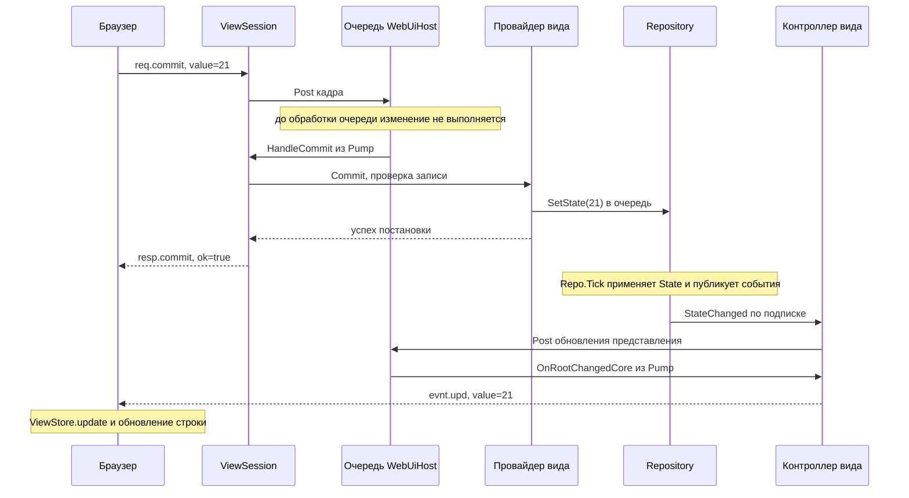
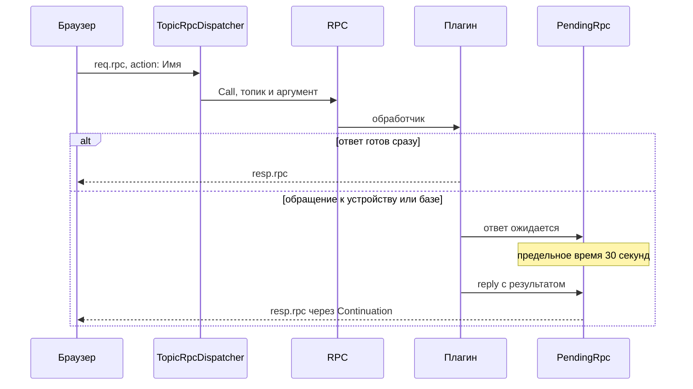

# WebUI
WebUI предоставляет браузерный доступ к системе двумя интерфейсами: WebIDE и Dashboard.

### Два интерфейса: IDE и дашборды

| | WebIDE | Dashboard |
|---|---|---|
| Что показывает | Дерево целиком, Inspector, лограммы, каталог и журнал | Заранее собранную страницу: графики, кнопки, регуляторы и другие компоненты |
| Протокол | `req.*`, `resp.*`, `evnt.*` с адресацией по `vid` | Табличные кадры `Connect`, `Publish`, `Subscribe`, `Action` |
| Кто собирает страницу | Предустановлен | Пользователь, файлами в `Output/www` |
| Сетевой доступ | Закрыт целиком | Разрешения определяются топиками |
| Фронтенд | Lit, каталог `www/ide` | Symbiote, каталог `www/components` |

Разные модели доступа являются архитектурным решением. WebIDE изменяет структуру и конфигурацию всей установки, поэтому его сетевой доступ закрывается целиком. Dashboard предназначен для повседневного использования и показывает только данные, разрешённые манифестами топиков.

Общими остаются порт и модель выполнения: сокет принимает кадр и ставит задание в очередь, а серверная логика сессии выполняется на движковом потоке.

Подробнее: [WebUiHost](../../(plugins/WebUI/WebUiHost.cs)), [ViewSession](../../(plugins/WebUI/ViewSession.cs)), [DashboardSession](../../(plugins/WebUI/ApiDashboard.cs)).

### WebIDE

WebIDE предоставляет представления дерева, Inspector, Logram, каталога и журнала. Строка представления адресуется идентификатором `vid`: команды передаются сообщениями `req.*`, подтверждения — сообщениями `resp.*`, изменения данных — сообщениями `evnt.*`. Ответ на команду означает «принято», а не гарантирует, что новое состояние уже опубликовано.

#### Каталог типов

Каталог открывается командой **Catalog** в контекстном меню корня дерева.
Он позволяет загрузить описания типов, обновить их и удалить установленное
поддерево. Страница реализована в
[catalog-document.js](../../Output/www/ide/components/catalog-document.js),
серверная сторона — в [CatalogViewProvider](Views/Catalog/CatalogViewProvider.cs).

Источник задан State топика `/$YS/Catalog/uri`;
значение по умолчанию — [https://enviriot.github.io/catalog/](https://enviriot.github.io/catalog/).
[CatalogSettings](Helpers/CatalogSettings.cs) создаёт этот конфигурационный
топик как Required/Readonly/Config: он не редактируется обычной записью из клиента.

| Каталог | Устанавливаемые топики |
|---|---|
| [mqtt-sn](https://enviriot.github.io/catalog/mqtt-sn/) | Описания устройств под `/$YS/TYPES/MQTT-SN`. |
| [TWI](https://enviriot.github.io/catalog/TWI/) | Серверные драйверы под `/$YS/TYPES/TWI`. |
| [LPLC](https://enviriot.github.io/catalog/LPLC/) | Блоки LogramPLC под `/$YS/TYPES/LPLC`. |

Установка описания типа не создаёт физическое устройство или экземпляр блока:
она добавляет топик типа с его State, Manifest и потомками.
Экземпляры создаются отдельно по правилам соответствующего плагина.

##### Навигация и index.json

В каждой папке каталога находится `index.json` — массив записей.
Папка задаётся полем `children`, устанавливаемый пакет — полем `src`.

| Поле записи | Назначение |
|---|---|
| `name`, `hint` | Имя и описание строки каталога. |
| `children` | Адрес подкаталога с собственным `index.json`. |
| `src` | Адрес загружаемого пакета; это не JS-код драйвера. |
| `path` | Путь топика для проверки установки, чтения `Manifest.version` и удаления поддерева. |
| `ver` | Предлагаемая каталогом версия. |

Примеры папки из индекса LPLC и пакета из индекса TWI:

```json
[
  {"name": "TWI", "hint": "Drivers for TWI devices on LPLC", "children": "TWI"},
  {"name": "HDC1080", "src": "HDC1080.xst", "path": "/$YS/TYPES/TWI/HDC1080", "ver": "0.4.1907.16000"}
]
```

Это иллюстрация двух видов записей, не общий индекс этих разных каталогов.
Относительные `children` и `src` разрешаются относительно текущей папки;
путь с `/` — относительно корня сайта; абсолютный HTTP(S)-адрес сохраняется.
Наличие файла в папке само по себе не добавляет строку каталога:
для установки через интерфейс нужна запись с `src`.

##### Download, обновление и Remove

1. При раскрытии папки сервер загружает её индекс и формирует строки.
2. По `path` ищется установленный топик и читается его `Manifest.version`.
3. **Download** (`req.rpc`, `download`) загружает пакет и применяет его к дереву.
   Сетевая загрузка выполняется вне движкового потока, применение результата —
   на движковом потоке через очередь WebUI.
4. Версия рядом с Download — `srcVer`, рядом с **Remove** — `actVer`.
   Для корректно разобранных версий повторный Download доступен,
   если предлагаемая версия новее установленной.
5. **Remove** (`remove`) удаляет топик по `path` вместе с его потомками.
   Для пакета типов это удаление описания, а не автоматическое удаление
   использующих его экземпляров и не откат их состояния.

Ответ RPC на Download подтверждает приём команды, а не завершение установки.
Результат виден по обновлению версии/кнопок; ошибки загрузки или применения
публикуются в журнале. Повторный импорт описаний не мигрирует автоматически
сохранённые настройки, связи или исходники экземпляров.

Версия индекса управляет предложением обновления в UI, а сервер отдельно
проверяет версии импортируемых топиков. Эти версии должны быть согласованы.
Формат пакета, экранирование и точные правила импорта находятся в
[Server.md](../../Server/Server.md#формат-xst), а не определяются каталогом.

##### Импорт и экспорт вне каталога

Корневое меню дерева содержит **Import**, меню топика — **Export**.
Они переносят выбранное поддерево: имена, пути, State, Manifest и потомков.
Это отдельный путь обмена данными, не требующий записи пакета в `index.json`.
Правила серверного импорта/экспорта те же, что при установке из каталога;
описание формата приведено в [Server.md](../../Server/Server.md#формат-xst).

#### LogramPLC constructor configuration

Constructor settings are shown above Tick ports: header, `cdr`-positioned
configuration rows, then a divider only when ports exist. Rows have labels and
values, not connection anchors. The schema is `mi.LPLC.mi.args.mi` of the block
type; saved values remain in the instance's `LPLC.args`. Runtime parameter order
is independent of layout. See [LPLC](../MQTT_SN/LPLC/LPLC.md#контракт-типа-и-экземпляра) for the shared
provider/validation contract.

The row and Constructor submenu use the same validated `set-arg` operation
with an argument name and typed value (or explicit unset). Static lists, device
pins, and supported/configured TWI/Serial resources require no block-specific
renderer or command. Readonly/derived values cannot be edited. Revalidate on
commit; a saved value that becomes invalid stays visible with a diagnostic.
Node fields `MQTT-SN.AvailablePins` and `MQTT-SN.AvailableUarts` constrain choices
when reported, independently falling back to type capabilities when absent.

`format` uses C# composite formatting (`0x{0:X2}`, `{0:F2}`), not custom tokens.
The server supplies invariant formatted text and geometry; local previews reuse
`Output/www/lib/stringformat.min.js` unchanged. Never replace numeric RPC/storage
values with formatted strings or globally change the formatter culture. TWI
addresses are lists only, without scanning, caches, or custom entry dialogs.
Structured configuration data must survive full-row replacement and patches;
changed row geometry recomputes wire endpoints. Editing does not start or upload
the program. Rebuild/reload is required to apply constructor changes.

`constructorRows` carries `name`, `label`, typed `value`, `format`, authoritative
`text`, `position`, `editable`, and optional `error`. `configurationError` also
reports hidden/schema/dependency errors at block level. Legacy `constructorArgs`
labels remain supported. Argument-row menu targets are `<block vid>/args.<name>`;
menu `args` contains `{name,value}` for `set-arg`, or `{name,unset:true}` for an
optional setting. Scalar entry uses `edit-arg` locally before the same validated
write. Configuration rows cannot be connected as pins.

Некоторые константы интерфейса, например размер клетки Logram и минимальный размер холста, дублируются на клиенте и сервере осознанно. Их согласованность проверяет [ClientContractTests](../../(Tests/ClientContractTests.cs)).

#### Путь правки из IDE

**Задача.** Превратить пользовательскую правку в изменение Repository
и вернуть его в открытое представление, не выдавая приём запроса
за уже применённое значение.

**Контракт и границы сценария.** Пользователь меняет числовой State топика
`/Demo/Value` с `20` на `21` в Inspector. Соединение установлено, строка
State открыта, запись разрешена; других записей и удаления этого топика
во время сценария нет. Сохранение на диск, MQTT, устройства, лограммы
и архивирование в этот маршрут не входят.



Редактор числа разбирает введённый текст и не отправляет значение,
которое не удалось представить конечным числом. `ViewApi.commit` формирует
запрос с `vid` строки и числовым `value`, а `ViewSession` ставит разбор
и выполнение в очередь движкового потока.
Сессия находит провайдера; `StateTreeController.CheckWritable` проверяет
запреты записи топика и, для вложенного поля, его описания.
При отказе возвращается ошибка без постановки этой правки в Repository.
Эти проверки не являются универсальной серверной проверкой числового типа
и всех прикладных ограничений произвольного клиента.

После успешной проверки контроллер передаёт `SetState` в
[очередь Repository](../../Server/Repository/Repository.md#очередь-изменений-и-тик-repository).
Тик применяет пакет, после чего
[подписка](../../Server/Repository/Repository.md#подписки)
уведомляет контроллер. Тот через очередь WebUI перечитывает текущее значение
и отправляет изменение строки; `ViewStore.update` применяет поля сообщения
к строке с тем же `vid` и уведомляет представление.

| Этап | Что он подтверждает | Чего он не подтверждает |
|---|---|---|
| Успешный `resp.commit` | Провайдер принял правку и поставил команду. | State уже изменён, сохранён или показан. |
| Применение на `Repo.Tick` | State стал `21`, для изменения создано событие. | Браузер уже получил обновление или данные записаны на диск. |
| `evnt.upd` и `ViewStore.update` | Серверное значение доставлено в модель открытой строки. | Завершение сохранения или внешнего действия. |

Ввод `21` может быть виден в редакторе как локальный черновик ещё до
серверного обновления; это не заменяет последний этап.
Изменение от другого компонента возвращается тем же путём `evnt.*`.

**Ограничения.** Соответствия «один `resp.commit` — один `evnt.upd`» нет:
Repository объединяет записи, а контроллер отправляет только изменившиеся
поля представления. При конкурирующих правках результат может отличаться
от `21`; эти условия исключены из примера. Получение подтверждения
не обходит очереди, и точное число миллисекунд до отображения не обещается.

**Реализация.** Опорные точки, не полный граф вызовов:

- [X13DoubleEditor.parse](../../Output/www/ide/editors/scalar-editors.js),
  [ViewApi.commit](../../Output/www/ide/services/view-api.js) — число и запрос;
- [ViewSession.Handle, HandleCommit](ViewSession.cs),
  [WebUiHost.Post, Pump](WebUiHost.cs) — очередь и ответ;
- [StateTreeController.Commit, CheckWritable](Views/InspectorState/StateTreeController.cs) —
  проверка и передача правки;
- [Topic.SetState](../../Server/Repository/Topic.cs),
  [Repo.Tick](../../Server/Repository/Repo.cs) — приём и применение;
- [JsonTreeControllerBase.OnRootChangedCore, SendUpd](Trees/JsonTreeControllerBase.cs),
  [ViewStore.update](../../Output/www/ide/services/view-store.js) — возврат в строку.

**Проверки.** [TopicStateFieldTests.SetState_IsAppliedOnTheTick](../../Tests/Repository/TopicStateFieldTests.cs)
и [RepoTickTests.Tick_AppliesEverythingBeforePublishingAnything](../../Tests/Repository/RepoTickTests.cs)
проверяют серверную границу применения и публикации.
Прямых тестов всей цепочки Inspector, отказа его commit и браузерного
отображения этого сценария в текущем наборе нет.
Эти проверки Repository не подтверждают сквозную работоспособность WebIDE.

#### Контекстное меню: Add и Action

Контекстное меню строится на сервере: на каждый запрос `req.menu` сервер собирает список пунктов для той строки, на которой его вызвали, а браузер только рисует полученное. Меню дерева собирает `MenuBuilder`; у панелей Inspector сборка своя, о ней ниже. Постоянная часть меню дерева — открыть, переименовать, вырезать, удалить, экспортировать — одинакова для всех топиков, а два раздела объявляют сами топики полями манифеста: `Children` даёт пункты **Add**, создающие дочерний топик, а `Action` — пункты **Action**, просящие плагин выполнить операцию.

Пункты Add ищутся по цепочке взаимоисключающих случаев, до первого сработавшего:

1. собственное поле `Children` — объект: пункты берутся из него, после чего к ним добавляются недостающие из `Children` типового топика;
2. собственное `Children` — строка: она читается как путь к топику, и пунктами становятся дети этого топика, а тип уже не участвует. Ребёнок, который сам не пункт, — папка-группа каталога: его пункты уходят в подменю с его именем, как у `/$YS/TYPES/LPLC/Math/ADD`. Имя пункта при этом должно быть единственным во всём каталоге: пункты различаются по имени, и из двух одноимённых в меню попадёт первый;
3. собственного поля нет: работает `Children` типа — объектом или строкой-путём, по тем же правилам;
4. ничего не нашлось: подставляются дети `/$YS/TYPES/Core` — Boolean, Double, Folder, Integer, Logram, Object и String.

Ключ объекта становится именем пункта, а сам объект считается пунктом Add, если у него есть `default` или `manifest`.

Пункты Action собираются из поля `Action` манифеста топика и из `Action` в состоянии типового топика; совпавшие имена берутся один раз, пункты сортируются по подписи. Имя пункта — это имя обработчика в RPC, и связь держится только на совпадении строки: объявленному действию `MQTT_SN.PLC.Build` отвечает `RPC.Register("MQTT_SN.PLC.Build", …)` в плагине MQTT_SN. Поэтому новая операция добавляется двумя независимыми шагами: плагин регистрирует обработчик, а топик или его тип объявляет действие с этим именем. Обычно `Action` — массив объектов, но подойдёт и объект, ключи которого станут именами.

Формат общих полей дескриптора (`default`, `manifest`, `willful`, `namePrefix`,
`menu`, `rc`, `icon`, `hint`) определён в [справочнике полей Topic](../../Server/Repository/TopicFields.md#общие-поля-state).
Здесь остаются правила их применения интерфейсом. При построении подменю
путь папки каталога ставится перед собственным `menu` записи.

Поля `path`, `name`, `text` и остальные данные описаний приведены
в разделах [схемы полей](../../Server/Repository/TopicFields.md#схемы-полей-state-и-manifest)
и [действия](../../Server/Repository/TopicFields.md#описание-действий).

Общее меню не читает `ddr`. В описании блока одна запись `Children` одновременно
может быть шаблоном создания и описанием визуального пина; различие между пином
и служебным ребёнком разобрано в [справочнике](../../Server/Repository/TopicFields.md#описание-дочернего-топика-и-пина).

Так выглядят фрагменты State топиков `/$YS/TYPES/Core/Integer`,
`/$YS/TYPES/Ext/DevicePLC` и `/$YS/TYPES/TWI` соответственно:

```json
[
  {"default":0,"editor":"Integer","icon":"Integer","manifest":{"attr":4,"editor":"Integer"},"willful":true},
  {"Action":[{"name":"MQTT_SN.PLC.Build","text":"Build programm"},{"name":"MQTT_SN.PLC.Run","text":"Run"}]},
  {"Children":"/$YS/TYPES/TWI"}
]
```

Выбранный пункт уходит на сервер как `req.rpc` с командой `add:<ключ>` или `action:<имя>`. В дереве её исполняет `TopicRpcDispatcher`: Add использует [механизм создания](#создание-топика-по-описанию), Action сверяет имя с тем, что топик объявил, и передаёт вызов в RPC — что происходит дальше, описано в разделе «Действие и отложенный ответ».

##### Создание топика по описанию

**Задача.** Создать дочерний топик из выбранного пункта общего Add.

**Контракт.** Сервер повторно разрешает шаблон по ключу и проверяет заявки `rc`.
Список занятых ресурсов строится по существующим детям: шаблон ищется по их
`MQTT-SN.tag`, если он задан, иначе по имени ребёнка. Исключительная заявка
конфликтует с любой занятостью, совместная — с исключительной.
Обычное меню скрывает занятые пункты, а RPC повторяет проверку и возвращает
`add_resource_busy`, если ресурс уже занят.

Имя выбирается по `willful`; `namePrefix` этот путь создания не использует.
Недопустимое имя и уже существующий топик дают ошибку. Новый топик получает
копии `default` и `manifest`. `Topic.Fill` устанавливает начальные данные сразу,
а событие создания Repository публикует позднее на тике.

**Границы.** Общий Add создаёт один топик и не разворачивает его `Children`,
в том числе записи с `Required`. Проверка ресурсов принадлежит этому пути
WebUI, а не Repository: это не глобальная блокировка для всех создателей топиков.
Содержимое шаблона не означает автоматической миграции существующих детей.

**Реализация.** [MenuBuilder.ResolveAddActions, ResourceBusy, BuildUsedResources](Helpers/MenuBuilder.cs),
[TopicRpcDispatcher.ExecuteAdd](Helpers/TopicRpcDispatcher.cs),
[Topic.Declare, Fill](../../Server/Repository/Topic.cs).

**Проверки.** [TopicTreeTests.Declare_CreatesTheTopicButAnnouncesNothing, Fill_SetsTheStateAtOnceAndAnnouncesTheTopic](../../Tests/Repository/TopicTreeTests.cs)
проверяют границу Repository. Они не проверяют выбор шаблона, `willful` и `rc` в WebUI; прямого набора тестов этого механизма нет.

##### Создание блока на диаграмме

**Задача.** Создать экземпляр выбранного блока и его обязательных детей.
Это отдельный путь WebUI, а не дополнительное действие общего Add.

**Контракт.** [LogramPaletteBuilder.BuildAddMenu](Views/Logram/LogramPaletteBuilder.cs)
обходит `/$YS/TYPES/LoBlock`; карточки распознаются по **Manifest самого описания**
с `type: "Ext/LBDescr"`. `State.icon` и `State.hint` оформляют карточку.
Наличие карточки ещё не гарантирует, что описание содержит исполнимый класс.

Команду `add-block:<путь-типа>` обрабатывает
[LogramViewProvider.ExecuteAddBlock](Views/Logram/LogramViewProvider.cs).
Имя формируется из `namePrefix` (по умолчанию `U`) и первого свободного суффикса
`01`, `02`, …; `willful` карточки игнорируется, диалога имени нет.
В копию `manifest` добавляются координаты `Logram.top` и `Logram.left`.
Затем создаётся экземпляр с начальным `default`, после него —
непосредственные дети из объектного `Children`, у которых в `manifest.attr`
есть `Required`. Каждый ребёнок получает собственные `default` и `manifest`.

**Границы.** Создание не рекурсивное, наличия `ddr` для обязательного ребёнка
не требуется. Остальные описанные дети автоматически не создаются.
Специальное меню добавления пинов предлагает отсутствующие записи с ненулевым
`ddr`; оно не отбирает их по `rc`, но выбранная команда `add:<имя>` идёт через
общий Add и проверяет ресурс при выполнении. Служебный ребёнок без `ddr`
не попадает в это меню.

Смысл полей и пример полного состава State — у
[справочнике полей Topic](../../Server/Repository/TopicFields.md#типы-блоков-logram).

**Реализация.** [LogramViewProvider.ExecuteAddBlock, CreateRequiredChildren](Views/Logram/LogramViewProvider.cs),
[LogramPaletteBuilder.BuildAddMenu, BuildAddPinItems](Views/Logram/LogramPaletteBuilder.cs).

**Проверки.** Прямых тестов автоматического имени, создания обязательных детей
и добавления пинов этим путём пока нет.

##### Меню полей Inspector

Панели Inspector строят своё меню Add по тем же правилам, но по другой схеме и с другим результатом. Дерево создаёт дочерний **топик** и берёт пункты из `Children`; панель State добавляет поле в **состояние** топика и берёт пункты из `Fields`; панель Manifest добавляет поле в **манифест** и берёт их из `mi`. Источники схемы накладываются друг на друга: у State это каталог типового топика, поверх которого ложится собственный манифест, у Manifest перед ними стоит ещё и общая схема `/$YS/TYPES/Ext/Manifest`. Спускаясь в поле, наложение спускается сразу по всем источникам, у которых этот ключ есть, а запасной каталог у всех трёх меню один и тот же — `/$YS/TYPES/Core`.

Отличий от дерева два. Пункт не предлагается, если поле уже есть; в манифесте это проверяется по `path`, когда запись идёт не в собственный ключ дескриптора — так `DashboardRO` пишет `dashboard.netRO`. И пунктов Action у панелей нет вовсе, только Add и Delete: действия в Inspector вызывают кнопки редакторов, а не меню. Уходят они в тот же `TopicRpcDispatcher.ExecuteAction`, причём всегда против корневого топика документа, а не строки поля, — поэтому правило «вызвать можно только объявленное имя» одинаково в дереве, в обеих панелях и в кадре `A` дашборда.

Подробнее: [MenuBuilder](Helpers/MenuBuilder.cs), [TopicRpcDispatcher](Helpers/TopicRpcDispatcher.cs), [SchemaOverlay](Trees/SchemaOverlay.cs), [модель топиков и типов](../../Server/Server.md#общая-модель-топики).

### История и живой журнал

WebUI использует [файловую историю серверного Log](../../Server/Server.md#файловая-история-журнала).
Формат файлов, срок хранения и правила времени принадлежат серверу;
панель не обращается к LiteDB и не разбирает файлы самостоятельно.

```text
req.log:  { beforeId?, count }
resp.log: { items: [{ id, dt, ll, msg }] }
evnt.log: { id, dt, ll, msg }
```

Сохраняются обычные поля маршрутизации и корреляции запросов.
Размер страницы по умолчанию — 50, сервер ограничивает его диапазоном 1–200.
Старое поле `before` с датой отклоняется явно. Файловое чтение выполняется
вне движкового потока, ответ и отправка WebSocket — на движковом потоке.
Живые события и ответы истории не попадают в подробную трассировку отправки
WebSocket: иначе журнал порождал бы собственные сообщения и вложенные копии страниц.

Если записей с файловым ID ещё нет, запрос без `beforeId` получает последние
записи. Если уже поступили `evnt.log`, обычная история запрашивается перед
самой старой загруженной файловой записью, включая скрытые фильтром строки.
Дальше границей служит ID самой старой записи полученной страницы.
Пустой `items` завершает чтение; неполная страница сама по себе не выключает
кнопку History. Отдельного `cursor` в ответе нет.

Живые записи продолжают поступать параллельно; пересечение устраняется по ID,
не по времени или тексту. `id=null` обозначает живое сообщение без
подтверждённой файловой записи: оно показывается, но не становится границей
истории и не сливается с другими сообщениями без ID.
После переподключения пропуск перед новым живым потоком догружается отдельно
до прежней известной границы. Если она недоступна, панель сообщает об этом,
а не объявляет пропуск восстановленным.

`dt` имеет вид `yyyy-MM-ddTHH:mm:ss.fff` без смещения. Дата и время отображаются
как серверные календарные значения, без перевода в часовой пояс браузера.
Существующий переключатель Debug действует и на историю; текстовый фильтр
по-прежнему применяется к загруженным строкам.

Ошибки истории видны в панели, не только в консоли. Clear очищает браузерный
буфер и границы чтения, но не файлы; ответы старого запроса после Clear
или смены соединения игнорируются. При выключенной файловой записи сервер
возвращает `log_history_unavailable`, не пустую историю.

Реализация: [LogHandler.BeginHistory](Views/Log/LogHandler.cs),
[ViewSession.HandleLog](ViewSession.cs),
[ViewApi.log](../../Output/www/ide/services/view-api.js),
[LogStore](../../Output/www/ide/services/log-store.js),
[X13LogPanel](../../Output/www/ide/components/log-panel.js).

Проверки: [LogHistoryHandlerTests](../../Tests/WebUI/LogHistoryHandlerTests.cs)
для сервера, [LogHistoryTests.mjs](../../Tests/WebUI/LogHistoryTests.mjs)
для API, объединения, пагинации и переподключения.
Панель также проверяется в браузере с изолированным имитатором API.

### Dashboard

Dashboard состоит из HTML-страниц и готовых компонентов в `Output/www`. Страница создаётся пользователем.

Право доступа объявляет сам топик полями `dashboard.netRW` и `dashboard.netRO` в манифесте.
Их формат — в [справочнике полей Topic](../../Server/Repository/TopicFields.md#dashboard).
Разрешение выбирается по наиболее конкретному совпавшему пути. Если подходящего объявления нет, доступа нет.

Эта модель не открывает редактор дерева наружу: сетевой пользователь Dashboard работает только с явно разрешённой частью данных.

Подробнее: [DashboardSession](../../(plugins/WebUI/ApiDashboard.cs)), [NetworkAcl](../../(plugins/WebUI/Helpers/NetworkAcl.cs)), [DashboardAcl](../../(plugins/WebUI/Helpers/DashboardAcl.cs)).

### Действие и отложенный ответ

Действие позволяет попросить плагин выполнить операцию над топиком. Доступное действие объявляется в манифесте, поэтому вызвать имя, которого топик не объявил, нельзя.



[Общий механизм RPC](../../Server/Server.md#rpc) маршрутизирует вызов и ограничивает
число ответов, но сам не гарантирует получение ответа. WebUI добавляет ожидание
отложенного результата и предельное время в 30 секунд. Без этого срока забытый
ответ оставил бы клиентский запрос незавершённым на всё время жизни страницы.

Этот путь используется контекстным меню дерева, действиями Inspector и кадром `A` Dashboard.

Подробнее: [RPC](../../Server/Rpc.cs), [TopicRpcDispatcher](Helpers/TopicRpcDispatcher.cs), [PendingRpc](Helpers/PendingRpc.cs).

---

[Вернуться к основному README](../../README.md)
